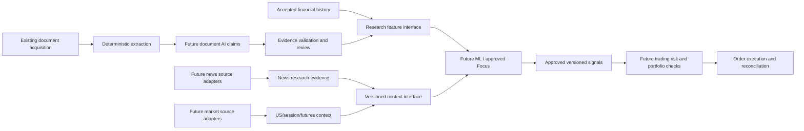

# Trading AI — incremental cleanup execution

**Version:** 2.9 · **Created:** 2 October 2026 · **Current action:** C08.3 lifecycle portability complete offline

**Objective:** clean the existing platform in small, verifiable chunks while preserving every current capability and the collected data. Reserve architectural space for ML, document intelligence, news/market research and trading; do not implement those future capabilities during this cleanup.

**Execution status:** C00 complete. C01 COMPLETE: C01.1/C01.2/C01.3 COMPLETE. C02 COMPLETE: C02.1/C02.2/C02.3 COMPLETE. C03 COMPLETE: C03.1 COMPLETE. C04 COMPLETE for offline preparation: C04.1 COMPLETE via fresh scoped revalidation; C04.2 and C04.3 COMPLETE for their isolated offline scopes. C05 COMPLETE for offline release preparation: C05.0/C05.1/C05.2/C05.3 COMPLETE for their isolated offline scopes. C06 COMPLETE: C06.1 COMPLETE for the authorized production activation. C07 COMPLETE: C07.1/C07.2/C07.3 COMPLETE. C08 COMPLETE for offline scope: C08.1/C08.2/C08.3 COMPLETE for their isolated offline scopes. C09–C27 not started. Future capability work is deferred. No cleanup chunk is authorized merely by being listed here. [C01.1 evidence](docs/cleanup/chunks/C01.md), [C01.2 evidence](docs/cleanup/chunks/C01.2.md), [C01.3 evidence](docs/cleanup/chunks/C01.3.md), [C02.2 evidence](docs/cleanup/chunks/C02.2.md), [C02.3 evidence](docs/cleanup/chunks/C02.3.md), [C03.1 evidence](docs/cleanup/chunks/C03.md), [C04.1 evidence](docs/cleanup/chunks/C04.1.md), [C04.2 evidence](docs/cleanup/chunks/C04.2.md), [C04.3 evidence](docs/cleanup/chunks/C04.3.md), [C05.0 evidence](docs/cleanup/chunks/C05.0.md), [C05.1 evidence](docs/cleanup/chunks/C05.1.md), [C05.2 evidence](docs/cleanup/chunks/C05.2.md), [C05.3 evidence](docs/cleanup/chunks/C05.3.md), [C06.1 evidence](docs/cleanup/chunks/C06.md), [C07.1 evidence](docs/cleanup/chunks/C07.1.md), [C07.2 evidence](docs/cleanup/chunks/C07.2.md), [C07.3 evidence](docs/cleanup/chunks/C07.3.md), [C08.1 evidence](docs/cleanup/chunks/C08.1.md), [C08.2 evidence](docs/cleanup/chunks/C08.2.md), [C08.3 evidence](docs/cleanup/chunks/C08.3.md).

## 1. How this file governs the work

Use this as the execution ledger for structural cleanup. The architecture blueprint explains the destination; this file specifies the sequence, change boundaries and evidence required to get there. Existing `scrapper/EXECUTION.md` remains historical acquisition implementation evidence, not this cleanup ledger.

The latest execution instruction selected **C08.3 only**: lifecycle state portability behind `./scraper`. The isolated candidate builds on C08.2, preserves the legacy shutdown-state format and host marker, configures an external state file and status bridge target, and checks writable identity before lifecycle actions. Offline gates passed; no production activation or live data/service change occurred. C08 is COMPLETE for its offline scope. C09 and later work remain unselected. Record evidence and stop after C08.3 completion.

When a chunk is selected, execute only that chunk and its explicitly selected subchunk. Complete the work, verify it, record evidence and the next smallest step, then return its result. Do not automatically run the rest of the plan. Larger headings below are containers for separately reviewable subchunks, not permission to make a large combined patch.

Allowed statuses: `NOT_STARTED`, `IN_PROGRESS`, `PREPARED` (reviewable change, not activated), `COMPLETE`, `BLOCKED` (state the actual missing prerequisite), `DEFERRED`, `SUPERSEDED`.

An offline structural chunk is complete when its selected scope and acceptance gate pass. A release-preparation chunk can complete without deploying. A production-activation chunk is complete only after authorized activation and its post-release gate. Tests passing never imply deployment approval.

For each future chunk record: selected subchunk, baseline commit plus uncommitted snapshot, paths touched, compatibility paths retained, behavior preserved or deliberately changed, production/data impact, tests and results, evidence paths/hashes, rollback, remaining limitations and next smallest chunk. Update only the selected status; do not mark a parent complete until all its selected required subchunks pass.

## 2. Source specification and conflicts

Reference copies are preserved inside the repository so execution does not depend on a Downloads path:

- [User-supplied cleanup blueprint](docs/architecture/cleanup-references/TRADING_AI_DEEP_ARCHITECTURE_CLEANUP_BLUEPRINT_V1.md).
- [User-supplied 171-module cleanup map](docs/architecture/cleanup-references/TRADING_AI_MODULE_INVENTORY_AND_CLEANUP_MAP.csv).
- [Repository architecture review](docs/architecture/2026-10-01/REPOSITORY_REVIEW.md), [source map](docs/architecture/2026-10-01/source-map.csv), and [report index](docs/architecture/2026-10-01/report-index.md).
- [Master Roadmap V4](TRADING_AI_MASTER_ROADMAP_V4_2026-09-29.md), plus later documented supersession such as [B2 supersession record](artifacts/b2-2026-10-01/B2_SUPERSESSION_RECORD.md).

Reference SHA256 values:

```text
Blueprint: 6054835ff84b30c552b034d03508cdd555afb37c2bf865981210e3f7388f4793
171-module CSV: c194acdf663cd51ab4cb111725cbba0ffcbacf6237b2ea6a3eb28335953ed7a1
```

The supplied blueprint describes snapshot `(7)`. The repository review describes the actual working tree, including uncommitted recovery code. At plan creation the repository is at `db7564a109f1cb34ee4e7d5ea3427716e14cb51e`, with existing tracked modifications and untracked rating identity/campaign files. This commit alone is **not** the full current application snapshot. C01 must capture those differences before execution.

This execution file adopts the user's capability-oriented folder map (`sources`, `documents`, `workflows`, grouped `db`, `operations`, `research`) rather than implementing two competing folder hierarchies. The earlier review's application/domain/infrastructure separation remains a dependency rule, not an additional parallel tree.

Corrections that govern execution:

- Main Compose has 16 definitions, five manual and eleven continuously configured roles; four additional browser definitions are finite campaigns. Definition count is not running-service count.
- `a2-review`, `b1-review`, and `b2-review` are copied review trees, not registered worktrees. Preserve unique changes before removing them.
- Preserve B2 draft code as audit history; do not activate superseded thresholds or equate absent-reference companies with reviewed negative labels.
- Do not assume the two different `065_*` migrations cancel each other. The ledger keys by full filename.
- Preserve existing Trendlyne behavior until caller/operator evidence proves inactivity. Its destination is not automatically `legacy/`.
- Shared download code does not mean direct-rating, generic and browser queues already share all timing, ownership or readiness guarantees.
- Read-only schema inspection can occur while services run. A planned consistent baseline/maintenance freeze is a separate action; shutdown is not required merely to read migration names.

If current code differs from the references, log the exact difference and adjust the selected chunk. Do not rerun a broad architecture audit or silently expand into a rewrite.

## 3. Non-negotiable preservation rules

1. Keep one canonical acquisition system, financial store, logical-document model and immutable content store. Reuse existing fetch/download/recovery/extraction components.
2. Preserve accepted financial history, raw responses/cells, company/period identities, first-observed and acceptance timestamps, source references, immutable original bytes/hashes, versions, attempts, retries and campaign evidence.
3. Keep standalone financial acceptance, current collection-scope semantics, delayed document-only refresh, workbook safety/source precedence, official transcript preference and recording allowlists.
4. Keep late publication, failed URL, alternate official source, saved rejected-page link repair and operator browser recovery as distinct strategies. Do not delete them as duplicates.
5. Preserve original HTML/PDF, browser DOM captures and generated derivatives as distinguishable content origins. Stored bytes do not automatically mean correct issuer/event, usable extraction or recovered evidence.
6. Keep `UNKNOWN`, not issued, not yet issued, unavailable, access blocked, discovered, downloaded, validated and technical failure honest. Optional documents do not invalidate an otherwise valid financial result.
7. Preserve CLI names/aliases/flags/outputs/exit codes, import paths and operator shutdown/wake order during transition. Keep `scrapper` as the package name.
8. Separate structural extraction from behavior/safety fixes. Declare any deliberate change, give it its own bounded subchunk and test the new contract.
9. Use an isolated development worktree outside production source mounts. Do not add review migrations or edit runtime application files through the active mounted checkout.
10. No live corpus relocation, database redesign, blind migration renumber/replay, mass financial recollection, bulk LLM reprocessing, Git history rewrite or automatic model training.

The existing roadmap explicitly states: **“No production changes without explicit approval.”** It also forbids “production bind-mounted development” in §2. This is the source of the production activation boundary here; ordinary documentation, isolated development and read-only review do not need a new blanket approval step. Existing session authorization for an exact action must be checked before requesting it again.

## 4. Target ownership, including future capabilities

The following is a destination map. Do not create empty packages or placeholder workers now. Create a directory only when a selected chunk moves real code into it.

```text
trading-ai/
  TRADING_AI_CLEANUP_EXECUTION.md       this execution ledger
  README.md                            product, runtime and documentation entry
  scraper                              small compatibility operator launcher
  compose.yml                          stable operator entry; role topology
  Dockerfile                           reproducible initial image

  scrapper/
    cli/                               thin grouped commands; final destination
    cli.py                             existing facade during early transition
    config.py                          compatible settings entry point
    core/                              small shared transport/value primitives
    domain/                            shared company/period/event/evidence contracts
    sources/
      screener/                        parsing, source clients and manifests
      exchange/                        masters, identities, result adapters
      documents/                       official recovery source adapters
      amc_workbook/                    existing workbook adapters
      mfdata/                          existing saved cross-check adapter
      trendlyne/                       retained unless proven inactive
      news/                            FUTURE: news source adapters
      markets/                         FUTURE: US/session/futures data adapters
    db/
      migrations/                      immutable historical migration identities
      common/                          connect, schema check, explicit migration
      screener/
      exchange/
      documents/
      mutual_funds/
      research/                        later approved feature/decision persistence
      intelligence/                    FUTURE: claims/news/context persistence
      trading/                         FUTURE: orders/fills/positions persistence
    documents/
      discovery/
      readiness/
      reconciliation/
      download/
      recovery/
        failed_download.py
        alternate_sources.py
        saved_screener_page.py
        browser_rating/
      extraction/                      deterministic PDF/PPT/OCR extraction
      ratings/
      transcripts/
      media/
    workflows/
      screener/                        fetch → ingest → acceptance → follow-up
      exchange/
      documents/
      mutual_funds/
    operations/
      coordinator/                     schedules bounded jobs
      workers/                         role lifecycle and dispatch
      monitoring/                      role progress, waits and failures
      health/
    research/
      features/                        one financial/document feature interface
      focus/                           approved rules and immutable decisions
      governance/                      labels, universe and cutoffs
      ml/                              FUTURE: dataset/train/evaluate/infer
    intelligence/
      documents/                       FUTURE: evidence-backed structured claims
      news/                            FUTURE: news research agent
      markets/                         FUTURE: US/session/futures context agent
    trading/                           FUTURE: signals, risk, execution, reconciliation
    exports/
    view/                              rendering and explicit command dispatch
    tests/                             retain test paths initially
    legacy/                            only verified retired compatibility code

  ops/
    docker/                            detailed configs + development override
    host/                              browser lifecycle + disk capacity publisher
    lifecycle/                         process selection, shutdown and restore
    campaigns/                         finite run manifests and reusable launchers
    runbooks/
  resources/                           small versioned reference inputs
  scripts/
    audit/
    maintenance/
    debug/
  docs/
    architecture/
    roadmap/
    research/
    cleanup/                           small per-chunk evidence summaries
    archive/                           immutable historical plans/statuses
  experiments/                         isolated exploratory/provider/model work
```

Avoid a simultaneous `cli.py` and `cli/` implementation switch: early chunks can use `cli_groups/` behind `cli.py`; a later explicit compatibility subchunk switches to a package with `__main__.py` only after invocation/import tests pass. Apply the same caution to existing files such as `documents/recovery.py`, `documents/extraction.py` and `validation/screener.py` before creating same-named packages. Move or re-export shared definitions first; do not rely on ambiguous import resolution.

Use only shared existing types in `domain/`. Do not introduce an enterprise object model or duplicate finance/document representations. Source-specific parsing stays at the source boundary, SQL at repository boundaries, workflows own business sequencing, and operations own scheduling/lifecycle.

## 5. Future ML, AI, news/markets and trading boundaries

### ML — `scrapper/research/ml/`

Reserved responsibilities: frozen dataset manifests, training/validation splits, model training, evaluation, model/version registry and reproducible inference. Feature construction belongs in `research/features/`; approved deterministic Focus rules belong in `research/focus/`. ML consumes those interfaces rather than reimplementing SQL acquisition or financial calculations.

Future module direction: `datasets.py`, `training.py`, `evaluation.py`, `registry.py`, `inference.py`. These are design names, not files to create now. Store datasets, trained weights and experiment output in configured data/model locations, not the source tree.

Inputs must retain issuer/period, feature version, cutoff, observation/source lineage, availability basis, null/applicability meaning, label version and universe. Training requires defensible dated labels and leakage checks; preserving B1/B2 does not satisfy those gates automatically. Inference produces a versioned research decision/signal with its input snapshot, never a direct broker instruction.

### Document-to-data AI worker — `scrapper/intelligence/documents/`

This is different from the existing deterministic extraction worker:

```text
existing logical artifact + immutable original bytes
  → documents/extraction: PDF/PPT/native text/OCR/pages
  → intelligence/documents: AI-assisted structured claims
  → validation + evidence/confidence/review status
  → research/features: approved document-derived features
  → research/ml or Focus enrichment
```

Reserved responsibilities: document selection, chunking, schema/prompt versions, model adapter, structured claim validation, citations, review/reconciliation and per-content caching. Reuse existing extracted pages/segments and source/content IDs; no second downloader, OCR corpus or financial database.

Every proposed claim should retain content hash/ID, extraction version, page/slide/span, issuer, relevant period, value/unit/qualifier, availability time, model/prompt/schema version and verification status. Unsupported claims remain unknown or require review. AI output must not overwrite accepted financial facts or original documents. Feature promotion is a distinct validated step, not automatic acceptance of model text.

Reserve an independently runnable `document-intelligence-worker` for later, separate from the existing `extraction-worker`, with bounded costs/retries and cache by content + extraction + model/prompt/schema version. It must not delay financial ingestion. Cleanup only makes the extraction/evidence interface usable; no prompts, model calls or bulk document processing now.

### News research agent — `scrapper/intelligence/news/`

Reserved responsibilities: issuer/topic monitoring, deduplicated news events, corrections, relevance/entity resolution, cited summaries and review status. `sources/news/` owns permitted feed/API adapters; the agent consumes those adapters and immutable captured evidence.

Retain publisher, source reference, source publication time, first-seen time, event time when known, correction/version history, entity links and the actual research cutoff. A later article or correction cannot be backdated into an earlier model decision. The agent outputs research evidence/context, not accepted financial facts or executable orders.

### US markets, sessions and futures — `scrapper/intelligence/markets/`

Reserved responsibilities: US/global market context, trading-session state, futures quotes and opening context, cross-market events and source freshness. `sources/markets/` owns data-provider adapters; instruments and timestamps must not be inferred from news prose.

Future inputs retain venue/instrument/contract, expiry where relevant, price field/unit/currency, exchange timezone, session definition, observation/source times and freshness. Distinguish spot, futures, premarket, regular open and overnight data; an expired or delayed quote remains identifiable. Later provider/entitlement/calendar selection is a separate implementation decision.

News and market-context agents can share event/evidence contracts while remaining separate tasks. Their future worker roles are `news-research-worker` and `market-context-worker`; choose scheduling and process isolation from actual latency/load later.

### Trading service — `scrapper/trading/`

Reserved responsibilities: approved signal intake, portfolio/risk checks, order intent, broker execution adapter, fills/positions and reconciliation. Suggested later modules: `signals`, `risk`, `orders`, `execution`, `reconciliation`, `portfolio`. Broker adapters belong behind this boundary; only this service may submit an order.

Trading consumes versioned approved signals/context through explicit contracts. It does not call acquisition parsers directly, scrape documents during order submission, or treat free-form AI/news output as an order. Future execution modes, broker access, risk limits and activation require their own implementation/release work; no credentials, paper/live runner, broker API or order action is introduced by cleanup.

### Future dependency map



This graph reserves interfaces; it does not say each future task must use an LLM, ML model, separate database or Docker container. Cleanup completion does not depend on building these products.

## 6. Runtime/data and process contracts

Keep existing `/data` volume and external `/documents` mount initially. Define configured locations and compatibility aliases first; do not move the large corpus as a cleanup prerequisite.

```text
configured runtime/data locations:
  database/              metadata DB, WAL and schema manifest
  snapshots/             captured original responses
  documents/             immutable bytes; may remain a separate external mount
  exports/               generated reports/features
  campaigns/<run-id>/    frozen selection and progress/residual evidence
  logs/
  browser-state/         per-run PID/lock/profile/temporary downloads
  backups/               consistent backups and restore evidence

future configured artifact locations:
  intelligence/          structured claim/news/context artifacts
  datasets/              frozen feature/label input snapshots
  models/                model weights and registry artifacts
  trading/               execution exports/audit material
```

Environment installations are tooling, not campaign data. Do not blindly move a `.venv` (entry-point paths may be embedded); reproduce a chosen locked environment at the new configured location and verify it. Stored `local_path` values must keep resolving; any physical data/path migration needs a resolver/remap and independent verification/rollback.

Initial cleanup roles remain coordinator, Screener worker, generic document worker, rating worker, extraction worker, optional alternate-source worker and finite operator browser campaigns. CARE/India Ratings/other may stay separate instances of one rating worker class. Future ML/AI/news/trading roles are documented only. Container count is not an acceptance target.

## 7. Standard chunk acceptance and rollback

For a structural extraction use this sequence:

```text
freeze selected behavior with existing tests/fixtures
  → extract one responsibility into its intended owner
  → old module delegates/re-exports and keeps its contract
  → verify old and new paths
  → move one caller group
  → verify again
  → record evidence and stop at the selected chunk boundary
```

Check references with `rg`, including dynamic dispatch, CLI commands, Compose, scripts, tests and operator runbooks. Zero direct imports alone does not prove an old path is unused. Remove a compatibility facade only in C26 after that audit.

Run targeted meaningful tests in isolated data under the chosen runtime. Reuse existing tests; add checks for changed ownership, migration isolation, host coordination, claims, handoffs and compatibility. Save exact commands/results. Before an actual release, run the relevant combined suite and end-to-end fixtures in the pinned production runtime. Report existing failures separately; do not call a failing release green.

Rollback for pure code chunks is the previous isolated commit/release, leaving data and migration history intact. Never discard another user's uncommitted work. For behavior changes or new durable work records, specify how old code reads the post-change schema and pending jobs. Schema removal or DB restore is not a routine code rollback; it can discard later legitimate writes.

Suggested evidence location: `docs/cleanup/chunks/<chunk-id>.md` for a small summary and paths/checksums to configured external evidence for large data. Do not commit copied DBs, model artifacts, extraction payloads or runtime logs merely to prove a chunk passed.

### 7.1 Global automated safety harness

**Principle:** if a cleanup rule matters, make the repository fail automatically where possible. These are mandatory acceptance gates, not a claim that automation already exists. Implement each harness component as a separately selected, bounded subchunk of its owning stage below; do not bundle them into C01. Until a required gate exists and passes, its dependent extraction or activation cannot complete. Record command, baseline, actual result and evidence; a prose assertion is not a passing gate. Mark a gate not applicable only with a concrete scope reason (for example H02 for documentation-only changes); offline code without DB-backed behavior uses applicable fixture equivalence rather than manufacturing a database workload.

| Gate | Required protection | Implementation / first required use |
|---|---|---|
| H01 | Per-chunk path and change allowlist | C01 isolated baseline tooling; every later selected subchunk |
| H02 | Pre/post data invariant fingerprints | C02 restored-clone tooling; every structural subchunk |
| H03 | Runtime environment and writable-target identity guard | Separate C05 safety subchunk; before C06 activation, extended in C08 |
| H04 | Migration identity/checksum audit in CI | C04 audit subchunk; before C05 release preparation |
| H05 | Two offline golden lifecycle flows | C01 inventory/design, separately selected C02 test subchunk; before C04 and structural moves |
| H06 | Queue state-machine specifications and contract tests | Capture touched queues before C12/C14–C18; complete inventory before C19 |
| H07 | Crash/fault-injection and ownership races | Separate prerequisite test subchunks before affected C19/C20/C21 changes; repeat for C22/C23 |
| H08 | Architecture and import-side-effect fitness tests | Baseline in C01; bounded enforcement in C04/C09/C10 and every layer extraction |

**H01 — exact scope:** before editing, declare exact allowed files (including tests, this ledger and evidence updates), forbidden paths and allowed change types. Prefer enumerated paths; narrowly scoped patterns require justification. Capture the baseline commit plus tracked/staged/untracked file manifest so existing dirty work is not blamed on the chunk. Check additions, deletions, renames, mode changes and uncommitted/untracked outputs as well as `git diff --name-only BASELINE..HEAD`; that command alone misses working-tree changes. Any chunk-owned path outside the allowlist fails. Amend scope explicitly before the additional edit, never silently or retroactively. No opportunistic refactoring.

**H02 — no data change:** use a consistent isolated DB snapshot with writers disabled and read-only fingerprint queries. Record actual schema/ledger identities, companies/periods, financial observations/accepted versions, source observations, logical artifacts, content metadata, download attempts, recovery targets/attempts, queue rows by state and extraction records. Compute deterministic ordered hashes for financial history, artifact metadata, company/period identity and schema, with documented serialization, null handling and stable columns. Record exactly which tables/rows and bounded stored-content sample were covered; metadata hashes are not a full-corpus byte audit.

A pure structural run must leave this fixed clone unchanged: before equals after. Tests that intentionally ingest/download/reconcile instead start old and new code from **separate copies of the same baseline**, use identical fixtures and a fixed clock, and compare resulting records/state/provenance and expected deltas. Any ephemeral exclusions must be named before execution; never blanket-exclude attempts, timestamps or entire tables to make a mismatch pass. An unexplained difference stops the chunk. Approved behavior changes use their own expected-delta contract. Never apply this equality test to an actively changing production DB.

**H03 — environment identity:** validate production/development/test and resolved DB, document-store and runtime write targets before directory creation, writable connection, migration or worker startup. Log those identities plus release ID, Git commit and image ID when applicable (explicitly unavailable for non-image runs); do not log secrets. Check configured production paths, symlink aliases, actual mounts and a production filesystem sentinel where supported. Development/test must refuse production writable targets, not merely use safe defaults. A marker copied in a restored clone needs an explicit isolated-clone identity verified against its destination. Any exceptional override must name the exact targets, be auditable and require production authorization when they are live; no general bypass flag. Test direct CLI, host-browser and container entry points and fail-closed behavior. Help/import stays inert; read-only inspection must not initialize a writer.

**H04 — migration lineage:** freeze a reviewed manifest of full historical filenames and SHA256 values from the reconciled C04 baseline. Audit duplicate prefixes/identities, changed or removed historical files, unknown/applied-but-absent ledger entries, pending files and actual filename ordering. The two known `065_*` histories are distinct full-filename identities: document their branch/DB applicability and narrowly allowlisted collision rather than renumbering, replaying or failing every build forever. New unexplained collisions and changed released checksums fail CI; new schema work gets a new migration. Pending repository migrations are an explicit expected set during preparation, not automatically corruption or approval to apply them. Release compatibility checks fail on unexplained ledger drift or unexpected pending work. CI uses disposable DB fixtures, never production access. A manifest frozen now proves future immutability; it cannot prove historical bytes without earlier release evidence.

**H05 — early golden flows:** reuse current fixtures/tests and production entry points with offline transport, isolated stores, fixed clock and deterministic responses; do not build a separate imitation pipeline.

- Flow A: new/revised result → quarter discovery/Screener fetch/parse/validation → accepted standalone version → expectations with one immediate and one missing document → delayed document-only refresh → late link promotion → canonical download/hash/store → extraction/readiness. Verify refresh leaves accepted finances unchanged and optional absence stays honest.
- Flow B: expected artifact → stale/bad URL → download failure → recovery → selected alternate/replacement/browser strategy → valid file attached to the **same logical artifact** → canonical persistence/downloader as appropriate to that strategy → immutable content → resolved evidence. Exercise distinct strategies as parameterized cases; browser-provided bytes need not be downloaded twice. Preserve ambiguous, unavailable and wrong-issuer/period outcomes.

Run both at baseline and after every relevant subchunk of C11–C23 (including C13), and before release. A broken flow blocks dependent work. C27 expands/reconfirms them with MF/source-version and feature cutoff/replay checks; it does not introduce the first lifecycle test.

**H06 — queue semantics:** derive tables from actual code and SQL, not example PENDING/RUNNING names. For Screener, generic downloads, direct ratings, recovery targets/source attempts, browser jobs, artifact reconciliation and extraction, record states, transitions, caller/owner, lease/renewal/expiry, attempt increment point, request/retry accounting, cooldown, terminal outcomes, requeue, idempotency, crash and restart behavior. Include evidence links and whether work is durable or currently an implicit loop. Freeze touched contracts before moving their owners and the full set before C19–C23. Any intended change gets a before/after transition table in its selected behavior subchunk; three claims must not silently become three network attempts.

**H07 — failure proof:** use isolated worker processes, controlled fault hooks, fake network/clock and restart. Inject failure after claim/before request; after response/before byte storage; after byte storage/before success; after artifact creation/before extraction enqueue; after extraction output/before state update; and after recovery candidate selection/before attachment. Race two workers for one job, expire/reclaim ownership, then test stale completion. Verify no lost eligible work, duplicate logical artifact, corrupted content, false success, permanently stranded active lease, incorrect double accounting or unauthorized host permit. Retry execution may repeat where the contract permits it; require idempotent durable outcomes rather than inventing an exactly-once guarantee. Test recovery of permits/cooldowns and pending handoffs before topology consolidation.

**H08 — dependency and inert-import tests:** use a small AST/import audit plus subprocess import/help/status checks with forbidden network, DB mutation, filesystem writes and thread/process startup instrumented. Cover real modules transitively; an import-only assertion is insufficient. Capture existing violations as exact files/edges with reasons and removal stage; CI forbids new violations and reduces this baseline as selected chunks fix them. Do not make a structural chunk silently fix every existing side effect.

Enforce the destination rules as layers are introduced: sources do not depend on workflows/operations/view; DB does not depend on CLI/view/operations; CLI has no SQL; view does not bootstrap/write DB state (explicit dispatch remains permitted); operations schedule workflows without parsing sources; research consumes public feature/evidence interfaces rather than source parser internals; document recovery reuses canonical artifact/content/download persistence. Compatibility facades need explicit, bounded transition exceptions. Do not reject all current `pipeline` imports before their staged migration.

### 7.2 Operational rules and minimum safe cleanup

- **Surgical diffs:** no project-wide formatter/import sorter, package rename, broad variable rename or typing conversion unless it is the expressly selected chunk. Preserve the `scrapper` package name.
- **Frozen provider corpus:** inventory existing permitted Screener/BSE/NSE/issuer-IR/CARE/CRISIL/ICRA/India Ratings and other touched-provider fixtures in C01; fill bounded gaps before each source move. Version normal, missing-field/changed-HTML, 404/403, HTML-as-PDF, wrong issuer/quarter, duplicate and redirect cases where applicable. Record fixture hashes/provenance and synthetic cases explicitly. Refactor gates are offline; new live fixture acquisition is separately scoped under existing publisher policy.
- **Lightweight performance baseline:** before affected refactors, measure fixed-fixture ingest time, transaction duration, claim latency, download/reconciliation/extraction throughput, SQLite busy/locked occurrences and peak memory on a recorded runtime/cohort. Agree tolerances before running comparisons; no arbitrary universal threshold. C19–C23 additionally compare concurrency/fairness and protection of the new-result lane. An unexplained material regression blocks completion.
- **Canary activation:** PREPARED → offline clone proof → authorized limited role/scope/cohort → observation gate → authorized widening. C06 and later role changes record cohort, observation interval, claim/retry/throughput/lock/output checks, shutdown/resume proof and stop/rollback criteria. Preserve one owner per job; never run old/new workers against the same unfenced queue just to create a canary. If a release cannot safely support mixed roles, rehearse a bounded stop/switch instead and document why. Canary approval is not blanket approval for full activation.

**Minimum Safe Cleanup milestone:** C01–C06 safety/isolation, C07–C10 repository/CLI and C11–C18 acquisition/document ownership, with their applicable harness gates passed. Record remaining limitations explicitly. At this milestone, separately scoped B1/B2/Focus/product work may run in isolated parallel work without waiting for C19–C27, with separate path allowlists and interface/merge coordination. Existing useful product work need not be frozen until this milestone where safe interfaces already permit it. This is not product authorization, does not revive superseded B2 thresholds and does not mark C19–C27 complete; operational improvements and remaining-domain cleanup stay separately selectable.

## 8. Execution ledger

Select one exact subchunk ID from this checklist. Parent IDs such as `C11` group work; use `C11.1`, `C11.2`, etc. for execution. Each subchunk inherits its parent's scope, prerequisites, preservation rules, applicable safety gates and rollback requirements. Selecting an ID does not waive those requirements. C05.0 retains its existing ID and precedes C05.1.

Copy this command and replace the ID:

```text
Read TRADING_AI_CLEANUP_EXECUTION.md and execute C01.2 only.
Do not begin another subchunk. Verify the selected scope, update its status,
return evidence and the next smallest step, then stop for review.
```

This checklist is the status ledger for individual subchunks. Update only the selected entry; a parent becomes COMPLETE only when all required subchunks pass. C10.7 is optional and must be explicitly selected if needed. Production activation retains the exact authorization boundaries defined below.

- [x] **C00 — specification and future ownership:** COMPLETE; this document and immutable reference copies only.
- [x] **C01 — baseline and isolated development:** COMPLETE.
  - [x] **C01.1 — full snapshot and isolated worktree:** COMPLETE ([evidence](docs/cleanup/chunks/C01.md)).
  - [x] **C01.2 — H01 scope-check tooling:** COMPLETE ([evidence](docs/cleanup/chunks/C01.2.md)).
  - [x] **C01.3 — existing golden/provider fixture inventory, import/dependency violation baseline and H05 design:** COMPLETE ([evidence](docs/cleanup/chunks/C01.3.md)).
- [x] **C02 — agreed maintenance freeze and recoverability:** COMPLETE.
  - [x] **C02.1 — authorized maintenance/backup/restore proof:** COMPLETE ([evidence](docs/cleanup/chunks/C02.md)).
  - [x] **C02.2 — H02 fingerprint tool on a consistent clone:** COMPLETE ([evidence](docs/cleanup/chunks/C02.2.md)).
  - [x] **C02.3 — H05 offline golden lifecycle tests:** COMPLETE ([evidence](docs/cleanup/chunks/C02.3.md)).
- [x] **C03 — preserve unique A2/B1/B2 work:** COMPLETE.
  - [x] **C03.1 — preserve unique A2/B1/B2 review work:** COMPLETE ([evidence](docs/cleanup/chunks/C03.md)).
- [x] **C04 — migration separation and lineage reconciliation:** COMPLETE for selected offline preparation; no production activation.
  - [x] **C04.1 — audit full filenames/checksums on copied schema, including both `065_*` histories, and add H04 manifest/CI checks:** COMPLETE via fresh scoped revalidation; original H01 gap preserved as historical evidence — [evidence](docs/cleanup/chunks/C04.1.md).
  - [x] **C04.2 — separate connection/read-only compatibility checking from explicit migration:** COMPLETE for isolated offline scope; candidate not activated ([evidence](docs/cleanup/chunks/C04.2.md)).
  - [x] **C04.3 — rebase only relevant A2 safety behavior against current browser-capable code and rehearse the proposed schema compatibility path:** COMPLETE for isolated offline scope; candidate not activated ([evidence](docs/cleanup/chunks/C04.3.md)).
- [x] **C05 — reproducible release and development configuration:** COMPLETE for isolated offline release preparation.
  - [x] **C05.0 — runtime environment/target guard (H03):** COMPLETE for isolated offline scope — [evidence](docs/cleanup/chunks/C05.0.md).
  - [x] **C05.1 — reconcile selected Python/dependency lock and runtime capabilities:** COMPLETE for isolated offline scope — [evidence](docs/cleanup/chunks/C05.1.md).
  - [x] **C05.2 — prepare production Compose with immutable images/no source mounts and a separate development override:** COMPLETE for isolated offline scope — [evidence](docs/cleanup/chunks/C05.2.md).
  - [x] **C05.3 — reproduce the release and clone tests:** COMPLETE for isolated offline scope — [evidence](docs/cleanup/chunks/C05.3.md).
- [x] **C06 — authorized release-isolation activation:** COMPLETE.
  - [x] **C06.1 — authorized release-isolation activation:** COMPLETE — [evidence](docs/cleanup/chunks/C06.md).
- [x] **C07 — root/docs/evidence ownership:** COMPLETE.
  - [x] **C07.1 — root README and current-status/supersession index:** COMPLETE ([evidence](docs/cleanup/chunks/C07.1.md)).
  - [x] **C07.2 — move one small docs/debug/script group and fix references:** COMPLETE ([evidence](docs/cleanup/chunks/C07.2.md)).
  - [x] **C07.3 — define generated-artifact retention/location manifests and tighten build context:** COMPLETE ([evidence](docs/cleanup/chunks/C07.3.md)).
- [x] **C08 — configured runtime and host-state boundary:** COMPLETE for isolated offline scope.
  - [x] **C08.1 — path configuration and existing-name aliases:** COMPLETE for isolated offline scope ([evidence](docs/cleanup/chunks/C08.1.md)).
  - [x] **C08.2 — host-browser PID/log/lock/environment configuration:** COMPLETE for isolated offline scope ([evidence](docs/cleanup/chunks/C08.2.md)).
  - [x] **C08.3 — lifecycle state portability behind `./scraper`:** COMPLETE for isolated offline scope ([evidence](docs/cleanup/chunks/C08.3.md)).
- [ ] **C09 — explicit reference import; remove hidden UI bootstrap:** NOT_STARTED.
  - [ ] **C09.1 — explicit reference import and inert UI bootstrap:** NOT_STARTED.
- [ ] **C10 — grouped thin CLI:** NOT_STARTED.
  - [ ] **C10.1 — registration/dispatch facade:** NOT_STARTED.
  - [ ] **C10.2 — exchange group:** NOT_STARTED.
  - [ ] **C10.3 — Screener group:** NOT_STARTED.
  - [ ] **C10.4 — documents/ratings/recovery group:** NOT_STARTED.
  - [ ] **C10.5 — MF/Trendlyne group:** NOT_STARTED.
  - [ ] **C10.6 — operations/views/research group:** NOT_STARTED.
  - [ ] **C10.7 — optional final `cli/` package switch:** NOT_STARTED.
- [ ] **C11 — Screener parser decomposition:** NOT_STARTED.
  - [ ] **C11.1 — shared source models:** NOT_STARTED.
  - [ ] **C11.2 — identity/metrics:** NOT_STARTED.
  - [ ] **C11.3 — profile/commentary:** NOT_STARTED.
  - [ ] **C11.4 — statements:** NOT_STARTED.
  - [ ] **C11.5 — growth/shareholding:** NOT_STARTED.
  - [ ] **C11.6 — document links and final assembly:** NOT_STARTED.
- [ ] **C12 — Screener validation/persistence/workflow decomposition:** NOT_STARTED.
  - [ ] **C12.1 — validation rule groups:** NOT_STARTED.
  - [ ] **C12.2 — source/blob/parsed observation persistence:** NOT_STARTED.
  - [ ] **C12.3 — financial/version acceptance persistence:** NOT_STARTED.
  - [ ] **C12.4 — fetch/ingest orchestration:** NOT_STARTED.
  - [ ] **C12.5 — company-quarter worker and document-only refresh callers:** NOT_STARTED.
- [ ] **C13 — exchange persistence and workflow ownership:** NOT_STARTED.
  - [ ] **C13.1 — snapshots:** NOT_STARTED.
  - [ ] **C13.2 — securities/corporate changes/identity:** NOT_STARTED.
  - [ ] **C13.3 — result filings/enqueues:** NOT_STARTED.
  - [ ] **C13.4 — schedule ledger:** NOT_STARTED.
  - [ ] **C13.5 — source transport/workflow callers:** NOT_STARTED.
- [ ] **C14 — discovery/readiness/delayed reconciliation:** NOT_STARTED.
  - [ ] **C14.1 — discovery/link promotion:** NOT_STARTED.
  - [ ] **C14.2 — expectations/readiness queries:** NOT_STARTED.
  - [ ] **C14.3 — delayed due checks/source refresh:** NOT_STARTED.
  - [ ] **C14.4 — quarter inventory/repair wrappers:** NOT_STARTED.
- [ ] **C15 — generic download decomposition:** NOT_STARTED.
  - [ ] **C15.1 — transport/media validation:** NOT_STARTED.
  - [ ] **C15.2 — persistence/derivatives:** NOT_STARTED.
  - [ ] **C15.3 — retry/host-health helpers:** NOT_STARTED.
  - [ ] **C15.4 — post-success reconciliation and worker orchestration:** NOT_STARTED.
- [ ] **C16 — recovery persistence decomposition:** NOT_STARTED.
  - [ ] **C16.1 — targets:** NOT_STARTED.
  - [ ] **C16.2 — leases/source attempts:** NOT_STARTED.
  - [ ] **C16.3 — candidates/attachment:** NOT_STARTED.
  - [ ] **C16.4 — extraction/download reconciliation and reports:** NOT_STARTED.
- [ ] **C17 — named repair strategies and latest link refresh:** NOT_STARTED.
  - [ ] **C17.1 — failed download/requeue/replacement/manual import:** NOT_STARTED.
  - [ ] **C17.2 — alternate BSE/NSE/issuer-IR/debt strategies:** NOT_STARTED.
  - [ ] **C17.3 — saved rejected-page link repair:** NOT_STARTED.
  - [ ] **C17.4 — October rating metadata refresh:** NOT_STARTED.
  - [ ] **C17.5 — diagnostic/report adapters:** NOT_STARTED.
- [ ] **C18 — browser recovery and lifecycle decomposition:** NOT_STARTED.
  - [ ] **C18.1 — ledger/run/cooldown/heartbeat operations:** NOT_STARTED.
  - [ ] **C18.2 — report validation and publisher adapters:** NOT_STARTED.
  - [ ] **C18.3 — canonical persistence/queue reconciliation/derivative processing:** NOT_STARTED.
  - [ ] **C18.4 — versioned bridge protocol:** NOT_STARTED.
  - [ ] **C18.5 — host runner and `./scraper` delegation:** NOT_STARTED.
- [ ] **C19 — worker lifecycle and fenced claims:** NOT_STARTED.
  - [ ] **C19.1 — shared bounded worker signals/heartbeat/idle/drain:** NOT_STARTED.
  - [ ] **C19.2 — generic/direct-rating/browser owner+claim fencing:** NOT_STARTED.
  - [ ] **C19.3 — long-job renewal/extraction ownership:** NOT_STARTED.
  - [ ] **C19.4 — normalized retry-attempt accounting and role health:** NOT_STARTED.
- [ ] **C20 — shared host permits/cooldown:** NOT_STARTED.
  - [ ] **C20.1 — reviewed publisher/host policy and durable permit contract:** NOT_STARTED.
  - [ ] **C20.2 — generic/rating executors:** NOT_STARTED.
  - [ ] **C20.3 — browser executors:** NOT_STARTED.
  - [ ] **C20.4 — Screener daemon/reconciler/collection monitor integration:** NOT_STARTED.
- [ ] **C21 — durable extraction handoff and finite quarter campaign:** NOT_STARTED.
  - [ ] **C21.1 — content/version processing work contract and crash-safe enqueue/reconciliation:** NOT_STARTED.
  - [ ] **C21.2 — deterministic extraction/normalization worker:** NOT_STARTED.
  - [ ] **C21.3 — represent June/browser backlog as finite configured campaigns:** NOT_STARTED.
- [ ] **C22 — coordinator and priority ownership:** NOT_STARTED.
  - [ ] **C22.1 — move existing exchange scheduling behind coordinator:** NOT_STARTED.
  - [ ] **C22.2 — bounded collection-scope scheduling:** NOT_STARTED.
  - [ ] **C22.3 — delayed expectations/recovery/housekeeping task dispatch:** NOT_STARTED.
- [ ] **C23 — staged Compose/process consolidation:** NOT_STARTED.
  - [ ] **C23.1 — one manual CLI profile with command compatibility:** NOT_STARTED.
  - [ ] **C23.2 — common generic executor with explicit eligible-scope allowlist/fairness:** NOT_STARTED.
  - [ ] **C23.3 — common rating worker class with host-configured instances:** NOT_STARTED.
  - [ ] **C23.4 — replace proven shell loops with role commands:** NOT_STARTED.
  - [ ] **C23.5 — remove drained dated extraction/campaign definitions:** NOT_STARTED.
- [ ] **C24 — mutual-fund/source/export organization:** NOT_STARTED.
  - [ ] **C24.1 — workbook inventory/holdings repositories:** NOT_STARTED.
  - [ ] **C24.2 — scheme acceptance/change/features:** NOT_STARTED.
  - [ ] **C24.3 — import/cross-check workflows:** NOT_STARTED.
  - [ ] **C24.4 — shared reporting writers and preserved Trendlyne adapter callers:** NOT_STARTED.
- [ ] **C25 — existing research interfaces and future architecture contract:** NOT_STARTED.
  - [ ] **C25.1 — source-independent financial feature facade and documented B1 disposition:** NOT_STARTED.
  - [ ] **C25.2 — governed Focus/label/cutoff ownership:** NOT_STARTED.
  - [ ] **C25.3 — document evidence/readiness interface:** NOT_STARTED.
  - [ ] **C25.4 — architecture contract for the reserved ML/AI/news/markets/trading domains:** NOT_STARTED.
- [ ] **C26 — verified copied-tree/dead-code retirement:** NOT_STARTED.
  - [ ] **C26.1 — remove archived copied review trees from canonical checkout only after C03 reproduction proof:** NOT_STARTED.
  - [ ] **C26.2 — archive proven inactive debug/experiment/legacy execution paths:** NOT_STARTED.
  - [ ] **C26.3 — retire zero-caller compatibility facades:** NOT_STARTED.
  - [ ] **C26.4 — relocate/untrack selected bulky generated artifacts using a verified retention manifest:** NOT_STARTED.
- [ ] **C27 — final parity and operational handoff:** NOT_STARTED.
  - [ ] **C27.1 — final parity and operational handoff:** NOT_STARTED.
The detailed scopes below are ordered. Subchunks inherit the parent's prerequisites but execute separately. Later offline design/preservation may proceed without blocking useful existing product work; production-affecting cleanup waits for release isolation.

## 9. Chunks C01–C06: establish a safe execution boundary

### C01 — baseline and isolated development

**Purpose:** identify exactly what must be preserved and create a development surface outside active production mounts.

**Subchunks, separately selected:** C01.1 full snapshot and isolated worktree; C01.2 H01 scope-check tooling; C01.3 existing golden/provider fixture inventory, import/dependency violation baseline and H05 design. Capture before tooling edits.

**Scope:** baseline metadata, uncommitted patch/untracked-file capture, service/config inventory and an isolated worktree; bounded harness tooling/baseline in isolation only. Do not edit mounted application code.

**Steps:** record Git commit/status, hash current changed application files and referenced configs, preserve untracked rating identity/campaign code with a manifest, inventory existing active roles and selected campaign status read-only, and create/verify the isolated worktree. Record baseline test behavior and known environment failures; never run report helpers that initialize live DBs.

**Gate:** the full current code state can be reconstructed, including uncommitted files; the development path is outside all production mounts; test data/output paths point to disposable storage; baseline evidence names the exact runtime and campaign snapshot.

**Rollback/evidence:** discard only newly created isolated work after preserving its patch; leave original working tree untouched. Record `C01.md`. **Next:** C02; C03 preservation analysis can begin read-only.

### C02 — agreed maintenance freeze and recoverability

**Prerequisite:** C01 and an explicitly selected maintenance window/stopping condition for current downloads/recovery.

**Subchunks, separately selected:** C02.1 authorized maintenance/backup/restore proof; C02.2 H02 fingerprint tool on a consistent clone; C02.3 H05 offline golden lifecycle tests. C02.2/C02.3 may use a safely obtained disposable consistent copy without awaiting a production maintenance window; this does not complete C02.1.

**Scope:** operational baseline and backups; separately selected isolated H02/H05 harness subchunks, not application refactoring. Clone-only test work does not require stopping production; the maintenance freeze/backup action retains its own authorization boundary.

**Steps:** record the selected finite campaign's completed/pending/review/unavailable/in-flight states. Finish or safely suspend its current work; do not wait for every periodic platform queue to become empty. Stop writers through the existing graceful lifecycle only when that action is authorized, keeping the host browser's bridge alive until it releases/commits its work. Take a SQLite-consistent backup using the backup API, restore it to isolated storage and verify integrity/schema queries. Record financial versions, identities, source/content references, queue/recovery/processing counts and storage paths at the same baseline. Preserve a bounded blob-hash/readability sample and document the corpus backup limits.

**Gate:** recoverable post-current-work DB copy, known lease/resume state and exact code/config baseline; no pending work silently abandoned. DB restore proof does not certify a backup or full hash audit of the external corpus.

**Rollback/evidence:** restart/resume only the recorded authorized roles under prior code/config if needed; never restore an older DB over live later writes. Record backup/restore paths, checks and maintenance outcome in `C02.md`. **Next:** C03.

### C03 — preserve unique A2/B1/B2 work

**Subchunks, separately selected:** C03.1 preserve unique A2/B1/B2 review work. This is the existing C03 scope under one selectable ID; no feature activation or copied-tree deletion.

**Prerequisite:** captured C01 baseline; use C02's verified copy for any database-backed comparison.

**Scope:** archival patches/branches/manifests; no feature activation or copied-tree deletion yet.

**Steps:** diff each copied tree against its documented original base and current canonical code. Preserve unique A2 migration-safety/access-block changes, B1 financial feature interface/tests and B2 historical draft/discovery work separately. Record applied/review-only/superseded states and reproduction instructions. Preserve small required inputs and hashes; do not carry embedded environments into source archives.

**Gate:** every unique implementation and audit-only draft is recoverable and classified; copied unchanged files are distinguished from unique work; no B2 superseded threshold is marked deployable.

**Rollback/evidence:** archive creation is additive; original trees stay until C26. Record branch/patch hashes and `C03.md`. **Next:** C04.

### C04 — migration separation and lineage reconciliation

**Prerequisite:** C01–C03; all changes in isolation.

**Subchunks, separately selected:** C04.1 audit full filenames/checksums on copied schema, including both `065_*` histories, and add H04 manifest/CI checks; C04.2 separate connection/read-only compatibility checking from explicit migration; C04.3 rebase only relevant A2 safety behavior against current browser-capable code and rehearse the proposed schema compatibility path.

**Scope:** `db/database.py`, current migrations, selected A2 patch fragments and relevant callers/tests. Preserve historical migration files/ledger identities. Do not merge all A2 changes or renumber historical files.

**Gate:** worker/report/UI initialization cannot apply a newly visible migration; read-only commands cannot create tables or write data; explicit migration works only on the disposable chosen DB when invoked deliberately. New/old code compatibility is demonstrated on a fresh restored copy, and expected/pending/extra filenames have an explained disposition.

**Rollback/evidence:** code rollback preserves ledger/schema; a forward schema change, if actually required, gets its own migration/compatibility record before production use. Record `C04.<n>.md`. **Next:** C05.

### C05 — reproducible release and development configuration

**Prerequisite:** prepared C04 safety changes.

**Subchunks:** C05.0 runtime environment/target guard (H03); C05.1 reconcile selected Python/dependency lock and runtime capabilities; C05.2 prepare production Compose with immutable images/no source mounts and a separate development override; C05.3 reproduce the release and clone tests.

**Scope:** Dockerfile, chosen dependency files/package metadata, Compose configs and release manifest. Retain all current source/document/media/operator behavior; defer image specialization.

**Gate:** code+dependency+image manifest is reproducible under the chosen production Python; all profiles lack production source mounts; storage/secret/resource settings retain their intended semantics; browser/OCR/TUI and separately required media capabilities are inventoried/tested. Development configuration cannot mount the production DB or document volume by default.

**Rollback/evidence:** previous image/config remains identified; no services are recreated in this preparation chunk. Record `C05.<n>.md`. **Next:** C06.

### C06 — authorized release-isolation activation

**Subchunks, separately selected:** C06.1 authorized release-isolation activation. This is the existing C06 rollout scope under one selectable ID; its exact production authorization and release prerequisites still apply.

**Prerequisite:** C04/C05 reviewable candidate, fresh compatibility/backup evidence and explicit authorization for this exact production rollout. Existing current authorization may satisfy this; do not request it twice.

**Scope:** activate only migration control, immutable runtime and specifically reviewed dependency/safety choices. No structural module moves, worker consolidation or automatic BSE resume.

**Steps:** recheck actual schema/config immediately before activation, use the prepared release, apply only separately required approved migration work, verify role health/progress and resume only the agreed prior work set. Keep current normal/browser publisher policies distinct.

**Gate:** no source mounts, no migration side effect on routine startup/status, old/new code compatibility, preserved queue/content/financial references and usable shutdown/wake. Record the exact activated image and any intentionally inactive review changes.

**Rollback/evidence:** prior compatible image/config; keep schema history and later data. Record `C06.md`. **Next:** C07. If activation is deferred, mark it DEFERRED and keep subsequent implementation in isolated development; do not pretend live isolation exists.

## 10. Chunks C07–C13: ownership and core financial paths

### C07 — root/docs/evidence ownership

**Subchunks:** C07.1 root README and current-status/supersession index; C07.2 move one small docs/debug/script group and fix references; C07.3 define generated-artifact retention/location manifests and tighten build context.

**Scope:** root documentation, `docs`, `scripts`, `experiments`, Docker ignore rules and reference paths. Campaign mutation scripts remain frozen evidence until reusable logic is extracted in C17/C18.

**Gate:** every moved reference/command resolves; current/review-only/superseded status is explicit; build context excludes unrelated artifacts/environments/secrets without dropping required runtime/fixture inputs. Large tracked payloads are not deleted/untracked here; `.gitignore` alone does not untrack them.

**Rollback/evidence:** reverse only the selected file relocation/config patch; original evidence hashes remain. Record `C07.<n>.md`. **Next:** C08.

### C08 — configured runtime and host-state boundary

**Subchunks:** C08.1 path configuration and existing-name aliases; C08.2 host-browser PID/log/lock/environment configuration; C08.3 lifecycle state portability behind `./scraper`.

**Scope:** `config.py`, host launcher/lifecycle and operator runbooks. Point to existing DB/document paths first; do not relocate stored content or rewrite `local_path` rows.

**Gate:** runtime path ownership is explicit; old config remains compatible; host capacity/sentinel/staleness checks stay intact; locked browser environment is reproducible outside campaign output; old shutdown-state reader remains usable; host closes before bridge/container shutdown. Parameters replace hardcoded run/container references without changing recovery semantics.

**Rollback/evidence:** old config/launcher with preserved runtime state, no data copying. Record `C08.<n>.md`. **Next:** C09.

### C09 — explicit reference import; remove hidden UI bootstrap

**Subchunks, separately selected:** C09.1 explicit reference import and inert UI bootstrap. This is the existing C09 behavior-boundary fix under one selectable ID; its compatibility and clone-test gates still apply.

**Scope:** `view/shell.py`, root exchange reference CSV, proposed resource path and explicit import command/service. This is a declared behavior-boundary fix, not a silent move.

**Steps:** extract CSV validation/import behavior, make it an explicit operator action, and make UI/search report an empty/uninitialized table rather than inserting rows. Separate ordinary schema checks from bootstrap. Retain a compatibility reference-file locator if needed.

**Gate:** shell/search/status performs no bootstrap writes or migrations; explicit import has validation, deterministic result/errors and clone tests; existing nonempty-table queries work unchanged.

**Rollback/evidence:** code/config rollback; do not remove legitimately imported rows. Record `C09.md`. **Next:** C10.

### C10 — grouped thin CLI

**Subchunks:** C10.1 registration/dispatch facade; C10.2 exchange group; C10.3 Screener group; C10.4 documents/ratings/recovery group; C10.5 MF/Trendlyne group; C10.6 operations/views/research group; C10.7 optional final `cli/` package switch.

**Scope:** 2,103-line `cli.py`, command adapters, registration and lazy imports. Extract one group at a time; keep services at old paths until their own chunks.

**Gate:** `python -m scrapper.cli`, `./scraper`, aliases, argument defaults, outputs and exit codes remain compatible; a lightweight command does not eagerly require every optional subsystem. Thin adapters add no SQL/business decisions. No hidden migration from help/report invocation.

**Rollback/evidence:** old dispatch facade and isolated commits; record command contract matrix and `C10.<n>.md`. **Next:** C11.

### C11 — Screener parser decomposition

**Subchunks:** C11.1 shared source models; C11.2 identity/metrics; C11.3 profile/commentary; C11.4 statements; C11.5 growth/shareholding; C11.6 document links and final assembly. Select only one extraction at a time; split these further if a fixture/transaction boundary requires it.

**Scope:** `sources/screener/company.py` into source-specific sibling modules. The old module re-exports old symbols; preserve private-helper callers such as the latest rating-link refresh until migrated deliberately.

**Gate:** old/new import paths produce equal golden records, raw cells, periods/units/missing states and document links across normal/irregular fixtures. No parser-version or output semantic change just to rename files.

**Rollback/evidence:** facade points to old implementation; no DB/schema action. Record `C11.<n>.md`. **Next:** C12.

### C12 — Screener validation/persistence/workflow decomposition

**Subchunks:** C12.1 validation rule groups; C12.2 source/blob/parsed observation persistence; C12.3 financial/version acceptance persistence; C12.4 fetch/ingest orchestration; C12.5 company-quarter worker and document-only refresh callers.

**Scope:** `validation/screener.py`, `db/repo.py`, `db/screener_discovery_repo.py`, `pipeline/screener_vertical.py`, `pipeline/screener_discovery.py`, relevant HTTP behavior. Move one responsibility/transaction at a time into `db/screener`, `workflows/screener` and source clients; shared types only into `domain`.

**Gate:** accepted/rejected decisions, raw evidence, standalone scope, revised-period handling, rule codes, collection floor and queue history remain equivalent. Document-only refresh preserves accepted financial versions. Do not change retry policy or eligibility thresholds here.

**Rollback/evidence:** compatibility facade/caller rollback; financial DB unchanged by structure. Record `C12.<n>.md`. **Next:** C13.

### C13 — exchange persistence and workflow ownership

**Subchunks:** C13.1 snapshots; C13.2 securities/corporate changes/identity; C13.3 result filings/enqueues; C13.4 schedule ledger; C13.5 source transport/workflow callers.

**Scope:** `db/exchange_repo.py`, `pipeline/exchange_universe.py`, exchange source/HTTP helpers and scheduler's application calls. Scheduling relocation comes later in C22.

**Gate:** E01–E06 targeted tests preserve ISIN identities, conflicts, absence safeguards, filing collisions, watermarks, revisions and A2 selected access states. Do not fix current MII schema/header mismatch or introduce a new result source in this move; those need separately selected source behavior work.

**Rollback/evidence:** prior repository facade; no migration/schema rewrite. Record `C13.<n>.md`. **Next:** C14.

## 11. Chunks C14–C18: preserve and organize the full document lifecycle

### C14 — discovery/readiness/delayed reconciliation

**Subchunks:** C14.1 discovery/link promotion; C14.2 expectations/readiness queries; C14.3 delayed due checks/source refresh; C14.4 quarter inventory/repair wrappers.

**Scope:** document discovery/promotion/result-artifact pipelines, `artifact_reconciliation_repo.py`, `reconcile_artifacts.py`, `quarter_documents.py` and reports. Group under `documents/{discovery,readiness,reconciliation}`, `db/documents` and `workflows/documents`.

**Gate:** result now/document later still creates expectations, performs bounded due document-only refresh, promotes correct issuer/period links and preserves financial acceptance. Absent/unknown/not-issued are not collapsed; recordings remain metadata unless separately governed.

**Rollback/evidence:** old facade/callers; existing due/retry records unchanged. Record `C14.<n>.md`. **Next:** C15.

### C15 — generic download decomposition

**Subchunks:** C15.1 transport/media validation; C15.2 persistence/derivatives; C15.3 retry/host-health helpers; C15.4 post-success reconciliation and worker orchestration.

**Scope:** `documents/downloader.py`, `run_document_download_worker.py`, download/queue/render repositories and accepted-document queue helpers. Preserve generic and rating-specific behavior separately.

**Gate:** bounded size/time/redirect behavior, publisher policy, immutable hashes/dedup, original/derivative origin, queue attempts, recovery reconciliation and storage failure refusal remain equivalent. Existing generic multi-scope support is retained; do not widen eligible scopes or merge queues here.

**Rollback/evidence:** old worker facade and helper contracts; same content/job IDs. Record `C15.<n>.md`. **Next:** C16.

### C16 — recovery persistence decomposition

**Subchunks:** C16.1 targets; C16.2 leases/source attempts; C16.3 candidates/attachment; C16.4 extraction/download reconciliation and reports.

**Scope:** `db/document_recovery_repo.py` into `db/documents/recovery` behind its old facade. Extract policy into the document recovery service only after persistence contracts are explicit.

**Gate:** DA-06 target/source claims, matching/attachment, ambiguous states, candidate release after failed extraction, immutable attempts/content and unknown-rating zero-coverage behavior pass existing tests. Transaction boundaries remain deliberate.

**Rollback/evidence:** old facade/delegation, no target/candidate/history deletion. Record `C16.<n>.md`. **Next:** C17.

### C17 — named repair strategies and latest link refresh

**Subchunks:** C17.1 failed download/requeue/replacement/manual import; C17.2 alternate BSE/NSE/issuer-IR/debt strategies; C17.3 saved rejected-page link repair; C17.4 October rating metadata refresh; C17.5 diagnostic/report adapters.

**Scope:** the current recovery pipelines/commands/source adapters and `artifacts/rating-link-refresh-20261001/refresh.py`. Extract reusable campaign logic; keep dated job lists and report snapshots as evidence.

**Gate:** recovered/replacement content attaches to the same logical artifact and uses existing persistence/downloads. Saved-page repair never accepts rejected finances. Rating refresh keeps verified company identity and frozen old/new link evidence; it does not pretend refreshed URLs are validated replacements or downloads. The recorded 87 companies/364 current links and exception 138/140 results remain historical evidence, not a new live-run target.

**Rollback/evidence:** previous facade/campaign selection; retain old URL/source/replacement provenance. Record `C17.<n>.md`. **Next:** C18.

### C18 — browser recovery and lifecycle decomposition

**Subchunks:** C18.1 ledger/run/cooldown/heartbeat operations; C18.2 report validation and publisher adapters; C18.3 canonical persistence/queue reconciliation/derivative processing; C18.4 versioned bridge protocol; C18.5 host runner and `./scraper` delegation.

**Scope:** current browser command trio, probes/progress/monitor, Compose campaign and host ops. Move one owner at a time into `documents/recovery/browser_rating`, grouped repositories and `ops/host`. Keep Docker-exec transport behind a configurable adapter initially.

**Gate:** operator scope/authorization, claim exclusivity, rate limits, current/verified former issuer names, OCR/missing-file handling, canonical persistence, generated-origin distinctions and shutdown/wake behavior pass. Keep publisher-unavailable reports distinct from technical failures. Review issuer/agency/event validation gaps separately; moving validator code does not prove exact-event correctness.

**Rollback/evidence:** prior launcher/bridge/protocol and compatible config; runtime state preserved. Record `C18.<n>.md`. **Next:** C19.

## 12. Chunks C19–C23: improve coordination before consolidating processes

These are declared operational behavior improvements, not cosmetic moves. Select and test them separately. If durable tables/columns are necessary, prepare the smallest additive versioned migration and compatibility/rollback evidence on a restored clone; production application remains explicit. Do not redesign existing queue history.

### C19 — worker lifecycle and fenced claims

**Subchunks:** C19.1 shared bounded worker signals/heartbeat/idle/drain; C19.2 generic/direct-rating/browser owner+claim fencing; C19.3 long-job renewal/extraction ownership; C19.4 normalized retry-attempt accounting and role health.

**Scope:** `operations/workers`, existing claim/finish paths and role wrappers. Keep queue tables/semantics except the specifically selected corrected ownership behavior.

**Gate:** a stale worker cannot finish a newer claim; crash/expiry/restart preserves history; signals finish/release only owned work; no DB write transaction is held during network/OCR. Verify browser pre-increment returned attempt count and intended bounded retry behavior. Idle/cooldown is healthy waiting, not failure; health checks prove schema/dependency/progress rather than only `SELECT 1`.

**Rollback/evidence:** prior compatible role code and handling of new claim state; stop unsafe overlapping replicas before rollback when necessary. Record `C19.<n>.md`. **Next:** C20.

### C20 — shared host permits/cooldown

**Subchunks:** C20.1 reviewed publisher/host policy and durable permit contract; C20.2 generic/rating executors; C20.3 browser executors; C20.4 Screener daemon/reconciler/collection monitor integration.

**Scope:** cross-executor max concurrency, next-request timing, cooldown/retry-after/circuit state and acquisition-mode policy. Preserve normal publisher restrictions and separate operator authorization.

**Gate:** concurrent workers across queues cannot exceed host/publisher limits; one blocked source does not stall unrelated hosts; administrative defer does not spend a request retry; host aliases/publisher groups and restart timing are explicit. Keep current partitions until this gate passes.

**Rollback/evidence:** original partitioned topology and compatible queue state; no policy bypass during fallback. Record `C20.<n>.md`. **Next:** C21.

### C21 — durable extraction handoff and finite quarter campaign

**Subchunks:** C21.1 content/version processing work contract and crash-safe enqueue/reconciliation; C21.2 deterministic extraction/normalization worker; C21.3 represent June/browser backlog as finite configured campaigns.

**Scope:** `quarter_extract`, scoped/browser processing loops, existing extraction/normalization records and worker dispatch. This is existing deterministic processing, not the future document AI worker.

**Gate:** every eligible saved content/version has recoverable processing work even if a crash occurs between persistence and enqueue; idempotent cache includes parser/OCR/options version; duplicate workers cannot process the same claim; original/derivative handling and failed/unknown evidence stay honest. June pending work is accounted for before its old loop is retired. No automatic full-corpus re-extraction.

**Rollback/evidence:** prior processing path plus explicit treatment of newly queued jobs; do not drop work records. Record `C21.<n>.md`. **Next:** C22.

### C22 — coordinator and priority ownership

**Subchunks:** C22.1 move existing exchange scheduling behind coordinator; C22.2 bounded collection-scope scheduling; C22.3 delayed expectations/recovery/housekeeping task dispatch.

**Scope:** preserve APScheduler retry ladder, catch-up, revisions, weekly reports and selected periodic role behavior. Coordinator schedules/enqueues bounded work; it must not serialize long fetch/OCR jobs inside one scheduling thread.

**Gate:** schedule cadence/misfire/catch-up behavior and source holds remain equivalent; accepted new/revised results have priority over old recovery/OCR; tasks remain idempotent and survive restart. No future news/ML/trading tasks are registered now.

**Rollback/evidence:** old schedules/worker loops with single ownership; avoid simultaneous duplicate schedulers. Record `C22.<n>.md`. **Next:** C23.

### C23 — staged Compose/process consolidation

**Prerequisite:** relevant C19–C22 gates, H06 state contracts, H07 failure/race tests and performance baselines pass. Each actual production role change has its own reviewed rollout scope.

**Subchunks:** C23.1 one manual CLI profile with command compatibility; C23.2 common generic executor with explicit eligible-scope allowlist/fairness; C23.3 common rating worker class with host-configured instances; C23.4 replace proven shell loops with role commands; C23.5 remove drained dated extraction/campaign definitions.

**Scope:** deployment topology only where equivalent execution contracts are demonstrated. Generic/direct-rating queue storage can remain distinct; alternate discovery can keep its own role.

**Gate:** before/after work accounting, scope policy, host limits, progress, CPU/memory and graceful lifecycle are equivalent or deliberately improved. `scope_id=None` is not authorization to drain every scope. Keep resource isolation that protects the new-result lane. No requirement to reach exactly four or five containers.

**Rollback/evidence:** prior image/role configuration and queue-compatible state, one ownership topology at a time. Record `C23.<n>.md`. **Next:** C24.

## 13. Chunks C24–C27: remaining domains, retirement and completion

### C24 — mutual-fund/source/export organization

**Subchunks:** C24.1 workbook inventory/holdings repositories; C24.2 scheme acceptance/change/features; C24.3 import/cross-check workflows; C24.4 shared reporting writers and preserved Trendlyne adapter callers.

**Scope:** `mf_workbook_repo`, related repositories/pipelines/exports and MF source clients. Keep pure parsers at their existing source boundary initially.

**Gate:** M01–M09 and relevant Trendlyne fixtures preserve bounded workbook safety, raw-cell lineage, ISIN matching, scheme IDs, consecutive-month behavior and source precedence. Frozen pilots are not expanded. Archive decisions wait for C26.

**Rollback/evidence:** prior facade/adapter selection and existing IDs/versions. Record `C24.<n>.md`. **Next:** C25.

### C25 — existing research interfaces and future architecture contract

**Subchunks:** C25.1 source-independent financial feature facade and documented B1 disposition; C25.2 governed Focus/label/cutoff ownership; C25.3 document evidence/readiness interface; C25.4 architecture contract for the reserved ML/AI/news/markets/trading domains.

**Scope:** existing `ml_contracts`, governance code, reviewed B1 tests/interface, B2 audit/discovery material and documentation. Forward-port only reviewed current behavior selected for this chunk. Preserve superseded B2 as audit-only; do not auto-merge draft selector code.

**Gate:** one financial feature interface and one document evidence interface preserve lineage, units, null/applicability states and actual as-of availability. No fabricated negatives or historic eligibility, no latest data backdating, no model training, LLM calls, news feed/provider integration or trading implementation. Future consumers have documented inputs/outputs and no direct acquisition-table dependency requirement.

**Rollback/evidence:** previous feature facade/contract version; retain review patches and historical outputs. Record `C25.<n>.md`. **Next:** C26.

### C26 — verified copied-tree/dead-code retirement

**Subchunks:** C26.1 remove archived copied review trees from canonical checkout only after C03 reproduction proof; C26.2 archive proven inactive debug/experiment/legacy execution paths; C26.3 retire zero-caller compatibility facades; C26.4 relocate/untrack selected bulky generated artifacts using a verified retention manifest.

**Scope:** only individually proven redundant/retired files. Removing tracked runtime logs does not mean deleting the operator's log data. No Git history rewrite, broad destructive cleanup or wholesale `OLD`/artifact deletion.

**Gate:** search static/dynamic/runtime/operator references; verify archive/file checksums and restore/access paths; release no longer imports retired paths; historical reports still resolve via manifest/index. Original/unique source and data remain recoverable. A file looking old is not evidence it is unused.

**Rollback/evidence:** restore selected code from archive/commit; generated artifact locations from verified manifest. Record exact file list, retention destination and `C26.<n>.md`. **Next:** C27.

### C27 — final parity and operational handoff

**Subchunks, separately selected:** C27.1 final parity and operational handoff. This is the existing C27 completion scope under one selectable ID; unresolved or deferred work must remain explicit.

**Prerequisite:** selected cleanup chunks have passed; unresolved/deferred items explicitly listed.

**Scope:** final release manifest, combined regression/end-to-end proof, operator documentation and truthful completion report.

**Gate:** one canonical source tree; thin compatible CLI; explicit migration application; immutable production code; configured data/state paths; documented owners for every current capability; meaningful worker progress and safe lifecycle; preserved financial/document/queue evidence; dated campaigns accounted for; copied review work preserved; future domains reserved without product implementation.

**Required end-to-end fixtures (rerun/extend H05, already established in C02):** new/revised result → accepted standalone version → immediate document expectations/promotion → delayed document-only recheck → same logical artifact → download/hash/store → extraction/readiness; failed URL → replacement/alternate/browser recovery as applicable → same artifact/evidence path with unavailable/unknown states preserved. Include MF/source-version and feature cutoff/replay checks.

**Operational validation:** perform only the selected authorized release checks; compare to the agreed fixed baseline and explain legitimate intervening writes. Do not compare changing live row counts as though no new results arrived. Bounded hash/path verification is not a full-corpus integrity claim; record what was and was not verified.

**Rollback/evidence:** last compatible release/runbooks and exact pending-work treatment. Record `C27.md`, remaining follow-ups and the new ownership map. Cleanup can be complete while future product work remains deferred.

## 14. Deferred product work — not cleanup chunks

The following remain `DEFERRED`; their names reserve ownership, not implementation permission:

- **F01 — document intelligence sample:** selected existing extracted documents, structured cited claims, human validation and cost/error evidence; no bulk corpus run.
- **F02 — ML feasibility and dataset/model work:** actual labels, eligible population, frozen cutoffs/features and honest leakage/evaluation gates.
- **F03 — news research agent:** approved sources/feed scope, entity/event contracts and correction/freshness evidence.
- **F04 — US/session/futures context:** provider/instrument/session definitions, permissions and reliable timestamp/freshness contracts.
- **F05 — trading service:** explicit signal/risk/execution contract, broker choice, environment and separate activation work.

These future tasks can reuse the cleaned interfaces independently. Deterministic financial Focus and useful existing acquisition must not wait for supervised ML, AI enrichment or a trading service.

## 15. Per-chunk completion record template

Copy this into the selected chunk's evidence file when work actually starts:

```markdown
# Cxx.y — selected responsibility
Status: NOT_STARTED / IN_PROGRESS / PREPARED / COMPLETE / BLOCKED / DEFERRED
Selected authorization/scope:
Baseline code commit + uncommitted snapshot manifest:
Baseline data/config snapshot (when relevant):
Prerequisites checked (including applicable H01–H08):
Allowed exact paths/change types + forbidden paths:
Chunk-owned tracked/staged/untracked diff versus captured baseline:
Data fingerprints / deterministic old-new replay and expected deltas:
Queue contract / fixture / performance evidence when applicable:
Files changed and compatibility facades retained:
Behavior preserved:
Deliberate behavior change (or none):
Production activation: none / exact approved release
Runtime identity guard / migration manifest evidence when applicable:
Canary cohort, observation gate, widening authorization (or none):
Database/schema/content impact:
Verification commands and actual results:
Evidence paths + checksums:
Rollback and post-change compatibility:
Known limitations / pending jobs / deferred items:
Next single smallest chunk:
```

**Next single smallest selectable chunk:** C09.1 — explicit reference import and inert UI bootstrap. C08.3 configures the wrapper shutdown-state path and status bridge while preserving legacy format and host/container ordering. No state/data relocation, stored-path rewrite, live lifecycle action or production activation occurred. C08 is COMPLETE for offline scope; C09–C27 remain unstarted. See [C08.3 evidence](docs/cleanup/chunks/C08.3.md). Execution stopped after C08.3 completion.
