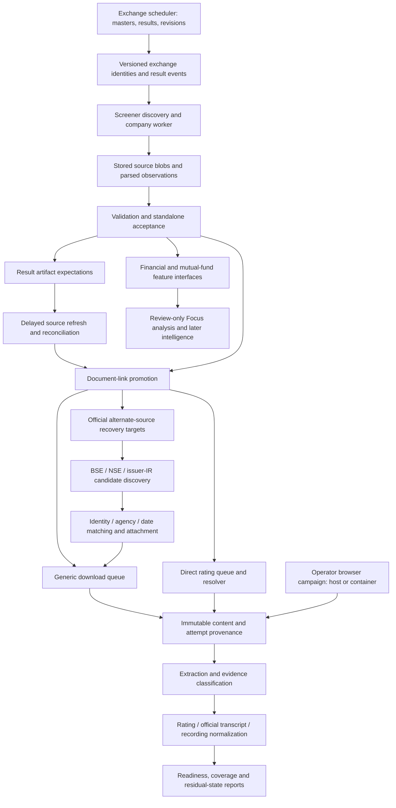

# Trading AI: repository structure and scalability review

Reviewed 1 October 2026. This is an architecture assessment and migration proposal, not an applied refactor.

## 1. Decision

Keep one application, one canonical financial store, and one logical-document/content model. Establish explicit ownership for acquisition, document recovery, processing, analysis, and operations. Split the large entry points and mixed repositories before reducing worker processes.

The primary problem is **unclear ownership across source code, operator scripts, deployment configuration, review copies, and generated evidence**. Container count is a symptom. Moving folders alone will not fix migration safety, cross-worker host coordination, ambiguous completion states, or the extraction handoff.

The destination should be a **modular application with independently runnable worker roles**. A microservice rewrite, replacement finance database, mass financial recollection, or new generic crawler would add risk without addressing the observed problems.

## 2. Evidence and review limits

The current checkout is `main`, commit `db7564a1`, with existing uncommitted recovery changes. Those changes were included in the assessment and left intact.

Static inventory covers all 226 canonical Python files: 78,420 lines, including 55 test files; application code accounts for 171 files and 56,451 lines. All files were parsed for definitions and imports. All 67 canonical SQL migrations were inventoried. The companion inventory records each file, hash, function location, imports, and proposed owner.

The report corpus contains 78 project Markdown documents and 8,048 lines, excluding vendored dependencies, old duplicated review documentation, and `OLD/`. These were inventoried and their status/evidence statements reviewed. The companion report index retains paths, hashes, headings, and status excerpts. Targeted JSON reports were reconciled, including the latest recovery and link-refresh summaries. The 23,000-plus extraction JSON payloads are generated document data, not 23,000 architecture reports; their contents were not all independently validated.

Detailed code tracing focused on entry points, configuration, migration application, queue claims/completions, scheduler, financial acceptance, delayed document discovery, generic and rating downloads, alternate-source recovery, browser recovery, extraction/normalization, host lifecycle, and the latest campaign scripts. Other modules were assessed through their definitions, imports, contracts, tests and reports. This is **not a claim that every one of 78,420 lines received an exhaustive semantic correctness review**.

Docker metadata was read without executing application commands: 14 running project containers, including a one-off discovery shell; two exited containers. The scheduler and document worker currently mount this host's `scrapper/` into `/app/scrapper` read-only, with writable `/data`; the document worker also has writable external `/documents`. No live database migration, row update, source fetch, worker restart, or deployment was performed for this audit. Live database contents, full corpus integrity and live host-browser activity were not re-certified.

The existing recovery/monitor/lifecycle suite passed **28 tests** on host Python 3.14.5 using the existing application environment plus the existing browser environment's Playwright package. Tests use mocks, in-memory databases and temporary files. This does not reproduce the production Python 3.12 image or prove a successful live publisher download.

## 3. Corrections to the earlier diagnosis

- Main Compose defines **16**, not 15, services. Five have the `manual` profile; eleven are configured to keep running. The browser overlay defines four finite campaign services. Definition count and running-process count must be reported separately.
- Manual Compose services are useful operator entry points. They do not consume resources unless started. Replacing them with one `cli` service improves consistency, but deleting them is not itself a scaling improvement.
- `scheduler.py` already uses APScheduler, with an IST retry ladder, bounded catch-up, prior-quarter revisions and weekly reporting. Reuse it; do not replace it with a new scheduler solely because other roles use shell loops.
- Generic downloads already support `scope_id=None`, multiple artifact-type filters, host rotation, durable leases, a same-host active-lease exclusion and host health. Multi-scope acquisition is partly implemented, not merely hypothetical.
- Direct credit-rating acquisition still has a separate queue, resolver and host-health table. The generic downloader is not yet a complete behavioral replacement for it.
- Rating claims already consult durable host concurrency and health. What remains missing is one shared host timing/ownership policy across generic, direct-rating, browser and Screener request paths.
- Browser recovery is a finite operational capability worth retaining. Its deployment packaging and internal ownership need improvement; it is not disposable just because the first run is dated.
- Most live data is already outside the repository: `/data` in a Docker volume and `/documents` on an external disk. The remaining problem is mixed defaults and state, plus large generated data tracked in Git.
- A2/B1/B2 are not all live application features. Review-only extensions and superseded drafts must not be promoted by a directory cleanup.

## 4. What is currently scattered

### Root

`compose.yml`, `compose.browser-recovery.yml`, `Dockerfile`, `scraper`, and `scraper-monitor` jointly control deployment and operator behavior. The root also contains the roadmap, three share ZIPs, exchange reference CSV, legacy cache/test helpers, credentials/state files, inbox, archives and review directories.

`scraper` implements several different meanings of lifecycle: pause/resume/start/stop target scheduler and daemon, while shutdown/wake cover the project and host browser. It uses project labels for shutdown but name matching for pause/resume. It records container names rather than a portable desired set of worker roles. `status` and the host bridge hardcode `trading-ai-document-download-worker-1`.

### Canonical package

`scrapper/` contains source adapters, infrastructure, domain rules, use cases, CLI, TUI, tests, source manifests, research, plans and a local data store. Its top-level folders provide a useful foundation, but ownership is inconsistent:

- `pipeline/` mixes ongoing use cases, worker loops, cohort/governance campaigns and final-gate report programs.
- `commands/` mixes thin CLI wrappers with large business implementations and macOS lifecycle management.
- `db/` includes persistence, business decisions, queue policy, file storage and HTML rendering orchestration.
- `documents/` mixes pure models/extraction rules with HTTP acquisition and a database-writing scope manager.
- `core/http.py` contains unrelated source-specific clients and response classification.
- `view/` mixes queries, rendering, command dispatch and writes. The interactive shell opens a writable connection and calls `init_db`; it also contains a CSV-seeding write helper.
- The legacy `screener/urls.py` is a compatibility wrapper around `sources/screener/urls.py`. It should be deprecated deliberately, not accidentally removed.

### Review copies and generated evidence

`git worktree list` lists the repository and one external worktree at `/private/tmp/trading-ai-rating-publish`. It does **not** list `a2-review`, `b1-review`, or `b2-review` as worktrees. Those are tracked copies inside this repository:

- `a2-review`: 372 tracked files, approximately 12.53 MB.
- `b1-review`: 282 tracked files, approximately 3.80 MB.
- `b2-review`: six tracked files, approximately 35 KB.

`artifacts/` has 23,413 tracked files whose current working-tree sizes total **13,273,180,207 bytes**. That includes 23,228 JSON files. This measures checked-out tracked files, not Git history size or total untracked runtime usage.

Some artifact folders contain executable production maintenance logic. The October rating refresh uses private parser helpers, verifies identity, persists fetches/links, and promotes documents. Other scripts directly rearm jobs or mark unavailable reports. These are operational commands living in what appears to be an output directory.

`.gitignore` does not remove files already tracked. The ignored `icra-download-test/` directory still contains a tracked runtime log. Share archives and generated JSON should eventually move out of the code tree through a verified retention/migration step; no evidence should be deleted during restructuring.

## 5. Current process map



Do not interpret arrows as universally automatic. Extraction is currently driven by commands, a hardcoded quarter loop and a browser-run processing loop; the store-to-extraction handoff is not one universal durable job queue.

## 6. Capability ownership: retain the full application

### Company financial acquisition

Owners today: `sources/screener/`, `validation/screener.py`, `db/repo.py`, `pipeline/screener_vertical.py`, `pipeline/screener_discovery.py`, `db/screener_discovery_repo.py`, reporting/collection scope modules.

Preserve source HTML, raw cells and normalized observations, exact periods, standalone-only financial acceptance, accepted pointers/history, peer/ratio/commentary behavior, incomplete-data distinctions, source identity, collection floor, reprocessing and bounded retries. Document-only refresh must continue to avoid accepting rejected financial data.

Split company parsing into identity/profile, financial tables, growth, shareholding and document-link parsers behind the existing `parse_company_page` facade. Split validation into named rule groups while keeping rule codes and report shape. Separate source/blob persistence, parsed observation writes and acceptance updates now concentrated in `db/repo.py`.

### Exchange identity, results and scheduling

Owners today: `sources/exchange/`, `db/exchange_repo.py`, `pipeline/exchange_universe.py`, `pipeline/scheduler.py`, exchange commands and reports.

Preserve ISIN-based identities, security versions, conflicts, listing/absence safeguards, symbol/name changes, snapshot guards, filing collision evidence, original and revised results, result-period watermarks, retry ladder and catch-up. Exchange masters are not the same population as research collection scope or a historical mentor universe.

Split the 1,583-line exchange repository into registry/identity persistence, version/event persistence, snapshots, filings, enqueue decisions and schedule ledger. Business matching/decision rules should move into services with explicit persistence calls rather than hidden SQL writes inside transport commands.

The coverage audit documents a real ISO-header mismatch (`FinInstrmNm`, `TckrSymb`, `SctySrs`) in the current MII feed. Preserve its exact schema contract as a future adapter fixture; do not fold an unreviewed parser expansion into structural moves or convert provisioned tokens into BSE codes.

### Mutual-fund and holdings pipelines

Owners today: AMC workbook, Trendlyne and mfdata source packages; workbook, feature, change and cross-check repositories; imports, feature derivation and exports.

Preserve bounded XLS/XLSX inspection, format-specific adapters, raw cell lineage, holdings normalization, ISIN matching, scheme registry/acceptance, consecutive-month changes, stock-month metrics, source precedence and frozen Trendlyne expansion. These should have a named `holdings` application/domain boundary, not disappear into a finance or documents rewrite.

### Documents, evidence and media

Preserve discovery, link promotion, all source references, immutable hash-addressed content, original/derivative distinction, generic downloads, rating resolution, alternate recovery, manual import, audited replacement/requeue, delayed expectations, extraction, OCR, official transcript preference, credit normalization, audio normalization, transcription adapter and recording allowlists.

Recording metadata must not become an automatic recording download merely because queues are consolidated. Genuine HTML reports and browser DOM captures must retain different provenance. Extraction success alone must not upgrade an unknown rating document to a recovered rationale.

### Governance, analysis and presentation

Preserve governed positive-label evidence and unknown negatives, feature lineage, timestamp semantics, quality/coverage reports, financial and document readiness as separate measures, and the TUI's existing operator commands.

B1's expanded company-quarter contract remains in `b1-review`; active `ml_contracts.py` is a different legacy interface. B2's draft threshold files and `focus_v1.py` are superseded/incomplete; the later discovery work is retrospective and explicitly not PIT-certified. A structural cleanup must not silently activate them.

## 7. Failed links: three distinct recovery systems

### A. Normal download repair

`pipeline/document_download_recovery.py` reports failures, audits requeue actions, attaches replacement URLs to the same logical artifact, and imports manual content. It retains the old URL/source and records replacement evidence. Generic and rating jobs may both be materialized for a replacement rating URL.

This belongs in document-acquisition application services. URL substitution needs exact artifact/company/event evidence; a more recent report for the same company is not automatically a replacement for an older event.

### B. Official alternate-source recovery

`db/document_recovery_repo.py` builds targets, leases source groups, stores candidate evidence, attaches reviewed matches, and reconciles after download/extraction. `pipeline/alternate_source_recovery.py` orchestrates bounded BSE/NSE/issuer-IR searches. Pure matching lives in `documents/recovery_matching.py`; source query/parse adapters live in `sources/documents/`.

Recovering means usable correctly matched evidence, not just finding a URL or receiving HTTP 200. Download or extraction failure must release the candidate when appropriate while retaining source, bytes, attempts and history. `UNKNOWN_RATING_DOCUMENT` provides no valid recovery coverage. These distinctions are already tested and must be preserved.

Split target/candidate/lease persistence from recovery arbitration and reconciliation policy; keep source adapters bounded. The 1,415-line recovery repository should not remain the sole place to understand this workflow.

### C. Finite operator browser recovery

Current path:

```text
./scraper shutdown / wake / status
  -> commands/browser_rating_host.py
  -> artifacts/icra-download-test/.venv + PID/log/lock
  -> commands/browser_rating_headed.py on macOS
  -> JSON-lines docker exec bridge
  -> commands/browser_rating_recovery.py in document container
  -> browser ledger + canonical download/content persistence
  -> extraction and rating normalization
```

Container browser workers claim from the same campaign ledger and use host filters. Browser recovery currently includes SQL seeding/claim/completion, heartbeat/cooldown, Playwright download, issuer validation/OCR, content persistence, queue synchronization, HTML/PDF derivative repair, extraction and JSON bridge dispatch in one 690-line command.

Make this a formal subsystem:

```text
application/documents/browser_recovery.py       orchestration
domain/documents/report_validation.py          pure validation contracts
infrastructure/db/browser_recovery_repo.py     jobs / claims / run evidence
infrastructure/browser/publishers/             ICRA, CRISIL, other adapters
infrastructure/browser/bridge.py               versioned transport protocol
ops/host/browser_recovery.py                   host process lifecycle
```

Keep the browser campaign's explicit authorization and finite scope. Make run ID, worker identity, bridge target, runtime directory and browser environment configurable. Keep graceful host shutdown before bridge/container shutdown, 180-second finish budget and resumability.

Start by isolating the existing Docker-exec transport behind an interface. A durable file spool or local API may later improve transfer and failure handling; that is a separate transport change, not a prerequisite for splitting modules.

## 8. Latest recovery evidence and what it actually establishes

`artifacts/rating-exception-recovery-20261001/report.md` and JSON record 138 of 140 original exception jobs saved: 28 CRISIL and 110 ICRA. Two ICRA originals remain unavailable: AvenuesAI/Infibeam, report 88721, and Bosch, report 3447. One additional CRISIL report for Shriram Properties was unavailable. The later issuer report was deliberately not substituted. These retain `FAILED` in the audit ledger with `PUBLISHER_SOURCE_UNAVAILABLE` resolution; the monitor separates them from technical failure.

This is recorded campaign evidence, not an independent new byte audit. The newly rerun 28 offline tests verify current code behavior; the campaign report's 24-test count reflects its own earlier boundary.

The separate link refresh's JSON summary records:

- 87 selected companies, 87 processed and refreshed.
- 364 current rating links.
- 111 old failed links still listed, five no longer listed.

The 364 current links are **not 364 replacements or downloads**. The 111+5 comparison counts cover the frozen old-job set and are not intended to equal 364. `refresh.py` explicitly does not enqueue downloads or accept financial observations. It stores HTML, verifies source company ID, parses rating links and promotes them. Absence of a previous link does not prove the corresponding report is unavailable.

Its reusable logic should become `refresh_rating_links(company_ids, publisher_filter, campaign_id)`, with an audited old/new link comparison. Keep the frozen campaign selection and atomic progress report. Exact company/agency/event matching is the next distinct stage; enqueue only verified new eligible targets. Preserve the current separation from financial acceptance, including when source document links come from a consolidated page.

Scripts that embed job-ID lists or placeholder PDFs should remain dated campaign evidence; extract only reusable operations such as audited rearm and unavailable-source resolution into tested services.

## 9. Highest-priority structural defects

### P0: mutable releases and automatic migrations

Evidence: live mount metadata; `db/database.py:50` and ordinary `init_db` calls; the A2 migration incident review.

Container-read-only source is still host-editable. Every ordinary `init_db()` discovers and applies absent SQL filenames. Status/report paths can also trigger this. Development changes can therefore alter a running application and schema without a deliberate deployment.

First prepare an isolated immutable release: no production source mounts, explicit migration command, worker compatibility checks that cannot apply migrations, clone rehearsal and a current verified backup. Reuse the A2 reviewed protection after rebasing it against the current browser work. Do not apply the old patch blindly.

### P0: migration identity differs across development streams

Canonical source has `065_operator_browser_rating_recovery.sql`, followed by browser 066/067. A2 review has `065_exchange_source_access.sql`; the incident report records that filename as already applied on 29 September. `schema_migrations` keys by full filename, so the prefix collision is not automatically a skipped migration. Both filenames can coexist in the ledger, and numeric head alone cannot describe deployment state.

Build a filename+checksum schema manifest and an explicit compatibility matrix for old application, browser-capable application and rebased A2 release. Inspect a fresh copied database before deciding a forward migration. Never rename previously applied migrations or restore an old DB merely to make numbering neat. Current live migration contents were not queried in this audit.

### P1: host throttling is split across execution paths

The generic queue enforces active same-host exclusion within its own table, and rating claims consult their own concurrency/health. Those guarantees do not span both queues, browser runs and Screener clients. `ScreenerHostClient` rate limiting is per instance; daemon, delayed reconciler and collection monitor can each own a separate client.

Create one durable host permit/cooldown service shared by all relevant executors. Model request timing, max concurrency, access policy, retry-after, circuit state and acquisition mode separately. Reserve the next allowed request time atomically, keyed by reviewed publisher/host group rather than assuming every hostname is independent. Keep existing limits until the shared implementation passes concurrency checks.

### P1: stale completion is inconsistently fenced

Generic `finish_download_job` validates leased status and owner. Direct rating `_finish_job` updates by job ID only. Browser `finish` also updates by ID only; its bridge validates ownership before processing, but the final update itself is not fenced. Browser `process_reports` selects unprocessed jobs without an extraction claim.

This is a scaling risk: a stalled worker that outlives a lease can complete after a new owner takes it. Introduce owner+claim token fencing for completion, per-content extraction claims and deliberate lease renewal for long work. Preserve single processing ownership until verified. This review did not reproduce a live stale-worker race.

Browser `claim` returns the row fetched before incrementing `attempt_count`; callers use that old count to decide `<3` retries. Verify and normalize the intended attempt limit before sharing retry code. Generic/rating claims return their updated rows.

### P1: browser validation does not prove the exact rating event

`validate_report` checks plausible PDF/HTML structure, rating-related text and current/verified historical company names. It does not independently require the expected agency and event date to match extracted report evidence. Those checks are stronger in the alternate-source candidate matcher. A valid report for the same company can still concern a different event, especially when the browser captures candidate PDFs from a publisher page.

Preserve the existing import path during module extraction, then add explicit issuer/agency/event validation and a review state for insufficient evidence. Do not infer exact-event correctness from a company-name match or the saved-file count. This is a static validation gap, not a demonstrated wrong attachment in the latest campaign.

### P1: content acquisition and readiness are conflated in some checks

Several browser and repair paths treat any `artifact_contents` row as existing content, while alternate recovery has special unresolved-candidate handling. Stored content may still be unknown, wrong, failed extraction or only a derivative. Keep existing persistence during structural splits, then introduce one explicit evidence/readiness selector for decisions about coverage and skipping.

### P1: extraction handoff is fragmented

The June worker polls `--period 2026-06-30`; browser processing scans run evidence JSON; scoped extraction uses another path. There is no single durable content-version job interface. Introduce an idempotent extraction work record keyed by content and parser/OCR/options version, reusing existing extraction records. Commit or reconcile the work item with content persistence so a crash between save and enqueue cannot lose processing.

Do not make optional document processing block a new financial result. Give current result ingestion priority and resource isolation.

### P1: repository/build/evidence boundary

13.27 GB of tracked artifact files, dated scripts and copied source trees hinder review, sharing, cloning and builds. The root Docker build context excludes `scrapper/store` and the application venv, but does not exclude artifact data, review copies, share ZIPs, `.env` or `.screener_csrf`. It copies only `scrapper`, so context and final image contents are different concerns; tighten the context deliberately.

Create artifact retention/manifests first, then relocate bulky payloads outside Git with checksums and stable references. Keep small curated fixtures, source contracts and audit summaries in the repository. Do not rewrite Git history or delete old evidence as part of a folder move.

### P1: inconsistent dependency and runtime contract

Docker installs loose `requirements.txt`; CI installs `requirements.lock`. The lock and range file themselves differ (for example locked Rich 15 versus an unbounded minimum, and `prompt_toolkit` absent from the lock). A2 reports prior production package drift. The host browser uses a separate Python 3.14 environment while recorded production is Python 3.12.

Create one package definition with explicit runtime/CLI/browser/extraction/test extras, a deliberate reproducible lock, and production-runtime checks. Initially keep the full current image to avoid dependency regressions; split acquisition and extraction images only after capability tests establish required packages and external tools. FFmpeg-dependent media support is reported separately from OCR support and should be an explicit media extra/image capability.

### P2: entry-point and repository concentration

`cli.py` is 2,103 lines with 64 literal parser registrations (including repeated aliases). `_parser` spans 831 lines and `main` 1,142. Eager imports couple lightweight commands to large optional dependencies. Make a registry of command groups with lazy handler loading; keep names, flags, outputs, aliases and exit codes.

Other useful splits: 1,577-line company parser, 1,536-line governance builder, 1,205-line workbook repository, 1,077-line Screener validation, 1,004-line Trendlyne validation, 844-line interactive shell, 788-line downloader. Split by responsibility and transaction ownership, not an arbitrary maximum line count.

### P2: lifecycle and health do not match application semantics

`SELECT 1` verifies SQLite accessibility, not queue progress, compatible schema, host cooldown, mounted storage freshness or bridge availability. Existing Docker health status must not be read as evidence of productive work. Add role-specific heartbeat/progress and expected dependency checks; cooldown/empty queue are healthy waiting states.

Make start/stop/pause/resume/shutdown/wake explicit about selected roles. Persist role/config/run identity rather than only container names, with a compatibility reader for existing shutdown state. Preserve disk-mount and sentinel checks and host-before-container shutdown ordering.

## 10. Proposed repository structure

Keep the package spelling `scrapper` during the initial transition so imports, CLI commands and operational scripts continue working. A package rename is an optional final compatibility change.

```text
trading-ai/
  README.md                         one product/runtime entry point
  pyproject.toml                    package and dependency extras
  requirements.lock                 reproducible chosen runtime
  compose.yml                       small stable role definitions
  scraper                           compatibility operator launcher
  scrapper/
    cli.py                          compatibility entry point
    interfaces/
      cli/                          command registry and group handlers
      tui/                          input/rendering; no hidden migrations
      queries/                      read-only company/coverage/progress views
    application/
      finance/                      ingestion, validation/acceptance use cases
      exchange/                     refresh, identity review, result ingestion
      holdings/                     import, normalization, derivation, crosscheck
      documents/                    discovery, promotion, acquisition, recovery
      processing/                   extraction and normalization handoffs
      analysis/                     approved feature exports and governance use cases
    domain/
      identity/                     identifiers and matching decisions
      finance/                      scope, periods, validation contracts
      holdings/                     scheme/holding/source-precedence contracts
      documents/                    artifacts, availability and evidence rules
      analysis/                     feature/label/cutoff contracts
    infrastructure/
      db/                           connections, migrations, repositories
      http/                         source clients + shared host coordination
      storage/                      immutable blobs and guarded document store
      browser/                      publisher adapters and bridge transport
      extraction/                   PDF/PPT/OCR/media engine integrations
    sources/                        keep existing parsers/adapters/manifests initially
    runtime/
      coordinator.py                schedules bounded work; priority and catch-up
      worker.py                     common signals, heartbeat, drain lifecycle
      roles.py                      role-to-handler configuration
    tests/                          preserve test paths initially
  ops/
    docker/                         image definitions and dev override
    host/                           browser lifecycle and disk-capacity publisher
    campaigns/                      reusable campaign runners + frozen manifests
    runbooks/                       start/stop/recovery/backup/release procedures
  scripts/
    maintenance/                    bounded reusable repair/import utilities
    audit/                          read-only repeatable audit utilities
  docs/
    architecture/                   this assessment and accepted decisions
    roadmap/                        current roadmap + explicit supersession index
    capabilities/                   actual implemented behavior
    evidence/                       small reports, manifests, external artifact refs
  experiments/                      inactive/provider/research prototypes
```

This is an end-state map, not a request to create empty folders or move every file in one patch. Retain `pipeline`, `db`, `documents`, `commands` facades while callers migrate. Keep pure source parsers where they are until a measured benefit justifies moving them.

Separating application/domain/infrastructure means separating dependencies and decisions; it does not mean implementing three parallel financial or document systems. The companion file map assigns every current Python file an initial owner and action.

## 11. Runtime data structure

```text
configured data root/
  metadata/                         SQLite DB, WAL, migration manifests
  source-snapshots/                  original captured responses
  exports/                          generated reports/features
  campaigns/<run-id>/                frozen input and progress evidence
  runtime/                          logs, PID/locks, shutdown state
  browser/                          isolated browser state if required
  backups/                          consistent DB backups and restore evidence

configured document root/           may remain on the separate external disk
  .trading_ai_document_store
  .trading_ai_document_store_capacity.json
  artifact_content/                 immutable hash-addressed bytes
```

Keep the Docker named volume and external document mount initially. External paths must be configuration, not source-relative defaults masquerading as production. Preserve existing environment variable names as compatibility aliases. The host browser environment is installed tooling, not campaign output; logs/PIDs/locks must not share ownership with a private `.venv`.

Existing database rows contain stored `local_path` values. Relocating bytes without a resolver or audited path remap would break extraction. First introduce logical storage identifiers/root-relative resolution or a compatibility map; verify file size/hash on a bounded sample, then migrate and retain old-path rollback capability. Do not duplicate the large corpus just to reorganize folders.

## 12. Worker/deployment structure

Aim for a small set of explicit roles, with configurable parallelism. Exact container count is an operational decision after host permits and queue claims are verified.

1. **Coordinator**: preserve exchange schedule/catch-up/revisions; schedule bounded collection-scope checks and delayed-document work. Avoid serially running long network/OCR work inside one scheduler thread.
2. **Screener worker**: financial/source ingestion with priority for new/revised results. Delayed document-only refresh uses the same host permit but separate task priority.
3. **Document worker**: generic downloads plus pluggable rating resolution, with scoped fairness and shared host policy. Initially retain separate generic and direct-rating executors beneath the role.
4. **Recovery discovery worker**: bounded alternate-source search. It may later share a worker pool, but long searches must not block download/new-result work.
5. **Extraction worker**: durable versioned content jobs, OCR/resource limits, explicit normalization handlers and retries.
6. **Browser campaign**: optional finite container executor plus a separately managed host executor where required.

One `cli` manual profile exposes operator commands. Five or six deployed roles may be reasonable; four mandatory containers is not proven. Source workers and recovery workers can remain separate where they protect latency or memory.

Consolidation order:

- Centralize common lifecycle/configuration first while retaining all existing queue schemas and service names.
- Let one generic executor serve selected normal/recovery scopes with a fair scope policy. `scope_id=None` alone is unsafe as a product policy: it could drain an operator-only or unapproved scope.
- Route existing rating queues through their existing resolver behind a shared worker interface. Prove source policy, landing pages, genuine HTML, interaction-required, retries and normalization equivalence before changing queue storage.
- Collapse CARE/India Ratings/other process partitioning only after shared host concurrency/timing/cooldown works across all executors.
- Replace the June loop with an explicit backlog campaign plus general extraction jobs. Do not abandon its pending work when deleting the old service.

## 13. Dependency and state contracts

The desired direction is interfaces/runtime -> application -> domain, with application accessing infrastructure through explicit contracts. Domain must not import CLI, Docker lifecycle or TUI. Source adapters retain source-specific parsing; repositories do not dispatch browsers or invoke feature workflows.

Use a small number of practical contracts:

- Company identity: verified internal ID plus versioned exchange/source identifiers; no name-only replacement assignment.
- Financial acceptance: standalone period/version, validation result, observation lineage and actual availability basis.
- Document evidence: logical artifact, source references, content/version, original/derivative origin, issuer/event match and readiness.
- Host permit: reviewed policy group, acquisition mode, current permit, next time, cooldown and retry reason.
- Work claim: queue kind, stable ID, owner, fencing token, expiry, attempt, result and immutable attempt record.
- Processing job: content ID plus parser/OCR/model/options version; bounded retry and reproducible cache key.
- Campaign: immutable manifest, allowed scope/hosts, run ID, expected end condition and progress/residual report.

Avoid a universal status field. Source availability, queue execution, stored content, extraction quality, semantic evidence and research readiness are separate dimensions. Translate existing states for a unified operator query without rewriting their audit history.

## 14. Scalability: what changes before adding replicas

SQLite WAL and `BEGIN IMMEDIATE` claims are a reasonable current foundation. They still serialize writers; adding containers does not create distributed database capacity. Inspect transaction duration, lock waits and claim-query plans on a restored clone before choosing a database change.

Improve bounded reads/writes: paginated exports rather than unbounded `fetchall`, scoped queue counts instead of repeated global scans, short transactions, explicit indexing for due/host/status/scope predicates, and cached/incremental monitor aggregates. Some monitor optimizations already exist; preserve them rather than rewriting all queries generically.

Shared host policy is a throughput constraint independent of CPU. Parallelize across permitted publisher groups and extraction jobs, not blindly within one source. Extraction/OCR is memory/CPU heavy; isolate it from the Q2 fast lane. Do not hold a DB write transaction while downloading or performing OCR.

Stay single-host while metadata is SQLite on one Docker volume. A future multi-host deployment would need a tested shared job/transaction store (for example a chosen server database) and shared immutable content storage. That is a separate measured migration, including all schema/transaction assumptions, not an implied part of folder cleanup.

## 15. What the reports imply for structure

- **A0** describes the local runtime, database/content split, consistent backup and differing universe denominators. It does not prove current byte integrity or complete financial-feature readiness.
- **A2** is a reviewed release patch plus an actual auto-migration incident. Its isolation/migration protections are not active in canonical source. The current browser migration stream requires a rebase and fresh compatibility check.
- **B0** establishes bounded financial exportability with historical availability limits, positive-only labels and no defensible supervised negatives. Keep current features and historical PIT certification separate.
- **B1** adds a review-only source-independent quarter-feature contract and 29-row retained-evidence reconciliation. It must become one approved interface after release review, not a second operational finance pipeline.
- **B2 draft** is superseded provisional work. **B2 discovery** is later retrospective association analysis; strict historical NOT_SELECTED remains unestablished. Preserve both with explicit supersession, never auto-load draft thresholds.
- **Coverage audit** has a newer current snapshot than the original B2 comparison. Its 389/389 current accepted June records do not rewrite the original frozen B2 denominator or establish historical availability.
- **August document reports** show successful bounded canaries and P0 drills, but the later final gate is RED with missing audit inputs, active work and integrity/storage checks incomplete. A module marked implemented is not a complete production corpus.
- **Retry diagnosis** shows a huge deferred bucket with attempt count zero. Do not count host deferral as an issued request or spend retry budgets through administrative rescheduling.
- **Storage reports** explain why host capacity publication is essential on Docker Desktop. Keep sentinel, reserve and stale-capacity refusal through any ops relocation.
- **FG-00** governance evidence remains useful; its older sequencing is superseded by the current roadmap. Label-free acquisition P0 and governed Focus P0 are different concepts.
- **Upstox** pilot is blocked and retired from active V4 work. It belongs in experiments and must not be started as a structural dependency.
- **AMFI/AMC research** is design/feasibility context, not proof that every proposed source is implemented.
- **October browser exception and link-refresh reports** describe separate bounded stages; only saved content plus later validation can establish evidence coverage.

Add one documentation registry with component, report date, code commit/hash, input snapshot, implemented/review-only/superseded state, production activation and evidence location. Current status should link to historical reports instead of overwriting them. This resolves conflicting `Done`, `RED`, `PARTIAL`, and `SUPERSEDED` claims without deleting history.

## 16. Migration sequence with reviewable boundaries

### Phase 0 — establish the release boundary

Prepare changes only in a real isolated worktree outside mounted `scrapper/`. Capture the current uncommitted recovery code into a reviewable patch/snapshot and preserve all campaign manifests. Reconcile approved code, full migration filenames/checksums and actual copied schema. Produce a reproducible Python 3.12 release candidate, explicit migration mechanism and no-source-mount production Compose; keep development mounts in a separate override.

Gate: clone migration and compatibility tests pass; backup/restore evidence exists; proposed release contains current browser capabilities and selected A2 protections. Production activation remains a separate explicit deployment decision. This audit does not activate it.

### Phase 1 — repository and documentation ownership

Add the root README and evidence/status registry. Move only small non-runtime documentation first. Define data/campaign/runtime paths with existing names as aliases. Move reusable audit and maintenance scripts behind stable wrappers; preserve original scripts as dated evidence. Prepare exclusion/retention manifests for bulky payloads and copied review trees.

Gate: commands can locate existing manifests/data; no evidence lost; no stored path silently broken. Removing already-tracked files requires an explicit migration patch, not merely `.gitignore` edits.

### Phase 2 — split interfaces without behavior changes

Introduce CLI group modules and lazy dispatch behind `python -m scrapper.cli`. Keep exact help/flags/aliases/exit codes. Extract TUI queries and mutation dispatch; make read-only commands use a read-only connection and schema validation without initialization. Split source-specific HTTP clients behind current imports.

Gate: existing command contracts and offline tests pass; report/status queries perform no schema/data writes.

### Phase 3 — formalize browser and repair ownership

Extract browser repository, validation, publisher adapters, bridge and application services one at a time. Parameterize current dated run/paths/container reference through compatibility defaults. Promote rating-link refresh into a focused metadata use case. Extract audited rearm/source-unavailable commands, retaining per-run evidence.

Gate: current browser test suite plus import/storage/derivative/extraction and stale-claim scenarios pass; saved content, original/derivative and publisher-unavailable semantics remain equivalent; shutdown/wake order unchanged.

### Phase 4 — common worker lifecycle and durable coordination

Replace shell loops with signal-aware bounded worker roles that support drain/daemon modes, structured exit reasons, heartbeat, idle/backoff and graceful completion. Add shared host permits, completion fencing and processing claims. Preserve current queue tables initially.

Gate: two-worker offline tests for the same host, stale owner, lease expiry, cooldown across queues, interruption, duplicate bytes, no dropped handoff and no policy bypass. New results remain independent of OCR/recovery backlog.

### Phase 5 — consolidate deployment where equivalence is proven

Make manual services one CLI role; combine generic scopes with explicit allowlisting/fairness; keep rating resolver semantics; retire completed dated loops through explicit campaign drain. Deploy only selected role changes after clone/offline evidence and approval.

Gate: before/after queue totals, content hashes, source references, accepted financial versions, readiness and pending work reconcile. Monitor role progress rather than only container health.

### Phase 6 — performance and later scale

Profile restored-clone workloads and optimize proven hot queries/transactions. Choose replicas/resource limits from measurements. Consider multi-host database/storage work only when single-host limits are demonstrated. Optional package renaming, physical test-folder moves and image-size specialization come last.

## 17. Preservation and verification checklist

The refactor must retain all existing public command behaviors and the following invariants:

- No accepted financial history deletion or consolidated-to-standalone substitution.
- No historic data/labels backdated from current snapshots or current market caps.
- Every source URL, attempt, replacement, candidate, byte hash and version remains traceable.
- Downloaded is distinct from extracted, usable, recovered and research-ready.
- Unknown rating evidence and unissued/unavailable documents retain honest states.
- Operator-browser authorization remains distinct from normal automated publisher policy.
- Optional documents do not disqualify an otherwise valid financial selection.
- Storage checks happen before network acquisition and persistence where required; absence/staleness fails closed.
- Host cooldown and global publisher concurrency survive service consolidation.
- Interrupt/restart cannot overwrite a newer owner or lose a durable processing handoff.
- Recordings stay governed; official transcript preference is preserved.
- Workbook format safety, source precedence and ISIN identity are preserved.
- Superseded Focus rules and blocked experiments stay inactive.

Use existing financial, exchange, workbook, recovery, extraction, storage, ML-contract and lifecycle tests as acceptance anchors. Add tests only for newly introduced coordination/migration/compatibility behavior. Test new migrations on a fresh restored copy under the chosen production runtime; report fixture proof and live evidence separately.

## 18. First concrete implementation slice

The first slice should be **an isolated, rebased release boundary containing the current browser recovery plus explicit migration control and immutable production mounts**. It should not reorganize every folder or consolidate every worker at once.

Then split browser recovery and CLI ownership through compatibility facades. These have clear seams and preserve the most recent useful capability while reducing the current cross-root/container/host coupling. Worker consolidation follows durable host policy and claim fencing, not the other way around.

Companion files:

- `source-inventory.json`: definitions/imports/hashes and proposed owner for every canonical Python file.
- `source-map.csv`: compact current-to-owner mapping, line count and initial action.
- `migration-inventory.json`: canonical SQL filenames/hashes and declarations.
- `report-index.md`: all 78 project Markdown documents with hashes/status excerpts.
- `review-metadata.json`: checkout, inventory, tracked-size and validation metadata.
- `collect_inventory.py`: read-only reproducible inventory generation; never imports application code.
- `structure-map.html`: portable searchable file/owner map and process/release summary; opens without network access.
